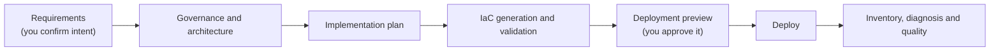

# APEX

**Design, validate and deploy Azure workloads with GitHub Copilot, one reviewed step at a time.**

APEX turns a conversation about a workload into reviewed requirements, an architecture with cost and policy
constraints, Bicep or Terraform, validation evidence and a deployment preview. You approve each decision that matters.
A deterministic runtime, not the model, owns the state, the gates and the evidence.

> [!WARNING]
> **Preview software.** The current release is `0.11.0-next.5`, published under the `next` tag. It targets
> **non-production** use: labs, demos and learning. Production deployment is blocked by design until its own approval
> and execution model ships. Live qualification of the supported clients is still pending. See
> [Project status](#project-status).

## What You Get

- **A guided workflow.** One APEX agent in your Copilot client walks you through requirements, governance discovery,
  architecture, implementation planning, IaC generation, validation, preview, deployment, inventory and a quality
  review.
- **Design that starts from policy.** Governance discovery runs before the architecture, so the design starts from known
  constraints. APEX uses a reviewed baseline of your subscription's Azure Policy when one exists. Otherwise it uses
  the shipped ALZ Corp reference baseline, which is an assumption about policy, not evidence of yours.
- **Rich, traceable output.** Requirements, architecture and cost decisions, implementation intent, validation results
  and operational documents are typed artifacts with a recorded lineage, not chat history.
- **Bicep or Terraform.** One IaC track per run, with the same governed outcome. Terraform applies the exact saved plan
  under native state locking.
- **Human approval before any change.** A deployment changes Azure only after you approve its exact preview. The agent
  guides, the kernel decides what is allowed next, and changed or stale inputs invalidate earlier approvals. The
  optional interactive bootstrap is separate: it can create a missing federation and Reader assignment for governance
  collection, but only after you confirm its own provisioning plan.
- **Both ALZ-backed workloads and standalone labs.** The deployment purpose (`lab` today) is separate from the
  foundation you build on.

## How It Works



In a `lab` run you confirm your intent once, after the requirements are reviewed, and approve the final deployment
preview. The architecture and plan checkpoints between them are recorded by the kernel when their required reviews and
validators pass; they never count as your approval. Each apply and each destroy needs its own preview and approval.

Three layers keep responsibilities separate:

| Layer              | Owns                                                                                       |
| ------------------ | ------------------------------------------------------------------------------------------ |
| **The kernel**     | State, gates, authorization, evidence and recovery. It is deterministic and has no model.  |
| **The agent**      | The conversation: asking, proposing and explaining. It follows what the kernel says next.  |
| **The validators** | Contract, policy, ownership and native-tool checks that decide whether a proposal is sound. |

Read [Workflow and gates](docs/explanation/workflow-and-gates.md) and
[Security and authority](docs/explanation/security-and-authority.md) for the full model.

## Supported Clients

| Client                           | Platform                | Start APEX                                                |
| -------------------------------- | ----------------------- | --------------------------------------------------------- |
| VS Code with the Copilot harness | Windows 11              | Set the session target to **Copilot**, then pick **APEX** |
| GitHub Copilot app               | Windows 11              | Start a local session in the project with **APEX**        |
| GitHub Copilot CLI               | Linux or WSL2           | Run `copilot --agent apex` in the workspace               |

Use one client per workspace. Local sandboxing should be on. No devcontainer is needed. Other combinations are not
qualified; see [client support](docs/reference/client-support.md).

## Quick Start

APEX has two parts: the `apex` Agent Plugin, which carries the agent, skills and MCP server, and the `@apexops/cli`
npm package, which sets up and checks your workspace. Install both at the same version.

1. **Prepare the host.** On Windows, follow [Prepare Windows 11](docs/how-to/prepare-windows-11.md). Turn on your
   client's sandbox. You need Node.js 24.21.0 or newer and Git.
2. **Install the plugin.**

   ```bash
   copilot plugin marketplace add jonathan-vella/apex-plugins
   copilot plugin install apex@apex-plugins
   ```

3. **Set up a workspace.** In an empty project directory, use the version shown by `copilot plugin list`:

   ```bash
   npx --yes @apexops/cli@PLUGIN_VERSION bootstrap --create-repo --yes
   ```

4. **Start APEX** in your client and describe the workload you want. The agent asks for the rest and tells you what it
   needs approved.

The full steps, including updating and resetting, are in
[Install, update and reset APEX](docs/how-to/manage-installation.md). First-run walkthroughs:
[Windows 11](docs/tutorials/windows-11-first-run.md) and
[Copilot CLI on WSL2](docs/tutorials/wsl2-vscode-consumer-runbook.md).

The `bootstrap` command above needs no Azure sign-in. The optional interactive governance setup is separate and does
need an authenticated Azure session, because it can check your account and provision the identity access that
governance collection uses. Deployments to Azure always go through an approved preview.

## Project Status

| Area                           | State                                                                                          |
| ------------------------------ | ---------------------------------------------------------------------------------------------- |
| Runtime, CLI and agent plugin  | Preview `0.11.0-next.5`, published to npm (`next`) and the `apex-plugins` marketplace           |
| Lab approval flow              | Implemented: one intent confirmation, kernel readiness checkpoints, final preview approval     |
| Bicep and Terraform tracks     | Implemented: Bicep runs through the `azd` executor (`CP-26`, awaiting `CP-30` live qualification); Terraform uses native CLI |
| Supported-client qualification | Pending. Live runs in the three clients are still to be recorded                                |
| Production deployments         | **Not available.** Planned as an opt-in, CI-owned run with verified human approval and setup help |

The scope, decisions and plan live in the [PRD](docs/vnext/PRD.md), the [roadmap](docs/vnext/ROADMAP.md),
the [decision log](docs/vnext/DECISIONS.md) and the [project checkpoint](docs/vnext/PROJECT.md).
Release notes are in the [changelog](CHANGELOG.md).

## Documentation

| I want to...                           | Read                                                                  |
| -------------------------------------- | --------------------------------------------------------------------- |
| Install, update or reset APEX          | [Manage installation](docs/how-to/manage-installation.md)             |
| Understand a run end to end            | [Run the workflow](docs/how-to/run-workflow.md)                       |
| Operate an existing project            | [Operate a project](docs/how-to/operate-project.md)                   |
| Look up commands and MCP tools         | [CLI reference](docs/reference/cli.md), [MCP reference](docs/reference/mcp.md) |
| Compare the Bicep and Terraform tracks | [IaC tracks](docs/reference/iac-tracks.md)                            |
| Understand the safety model            | [Security and authority](docs/explanation/security-and-authority.md)  |
| Browse everything                      | [Documentation index](docs/README.md)                                 |

## Contributing

Contributions are welcome. APEX is developed in this repository from issues, with conventional branches and commits
and one focused change per pull request.

```bash
npm ci
npm run build:vnext
npm run validate:vnext
```

Read [CONTRIBUTING.md](CONTRIBUTING.md) and [AGENTS.md](AGENTS.md) before opening a pull request. They explain the
package layout, the validation each kind of change needs, and the rules for the kernel, contracts and managed skills.
The [project hub](docs/vnext/README.md) holds scope, risks and qualification procedures.

| Path              | Purpose                                                                        |
| ----------------- | ------------------------------------------------------------------------------ |
| `packages/`       | TypeScript contracts, kernel, capabilities, renderers, testkit and the CLI     |
| `customizations/` | Canonical source for the agent, skills and hooks that ship in the plugin       |
| `config/`         | Versioned workflow, policy, toolchain and quality contracts                    |
| `infra/`          | Bicep and Terraform qualification infrastructure                               |
| `tools/`          | Validators, packaging, live qualification and project utilities                |
| `docs/`           | Product documentation, plus project controls under `docs/vnext/`               |

## Security

Report vulnerabilities privately; see [SECURITY.md](SECURITY.md). Cloud deployment, package publication and release
cutover are explicit, maintainer-authorized operations, and local tests do not replace the live evidence the
[acceptance criteria](docs/vnext/PRD.md#cutover-acceptance) require.

## License

MIT. See [LICENSE](LICENSE).
