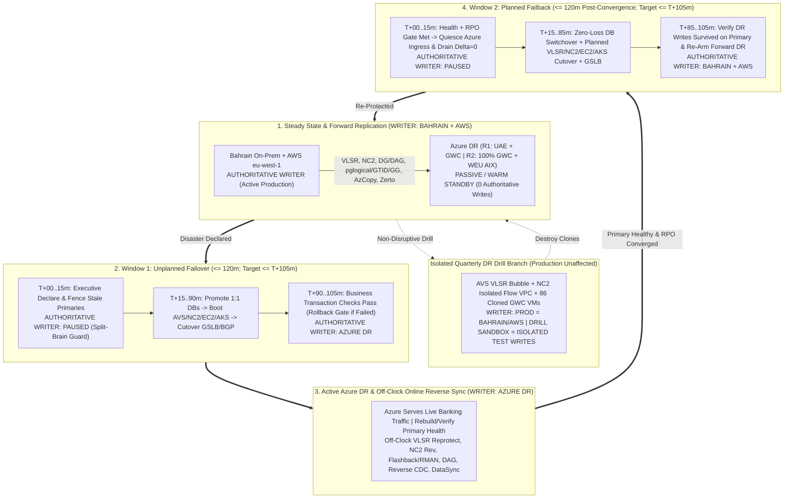

# NBB Cloud DR RFI v2 — Technical & Commercial Research Findings

> Generated by Copilot research orchestrator | 2026-11-20 | Baseline commit: `6f6443c5aae61ab03ee8c0bf347ee00f96db78a2`

**Status:** Research complete; awaiting review before modifying `agent-output/nbb-cloud-dr-rfi/`.[^1]

## 1. Executive Summary & Blocker / Decision Register

Executing the NBB Cloud DR RFI research plan[^1] against the extracted eight-sheet customer inventory[^2] and hardened
v2 advisory response[^3] confirms that the core dual-hypervisor (`AVS` + `NC2`), `1:1` database/Kubernetes parity,
CBB-gated regional (`R1` vs. `R2`), and two-window (`<= 2h` failover / `<= 2h` post-convergence failback) architecture
is structurally sound and commercially consistent (`R1` `$129,689.70/mo` | `R2` `$123,470.74/mo` 3-Yr Optimized).[^4]
However, primary-source verification against Microsoft Learn and vendor documentation uncovered **14 material findings**
— including **five design/tooling blockers** that fail as currently written (`Veeam` cross-cloud EC2 continuous
replication, `AzCopy` reverse `Blob -> S3` failback, `AKS` `Storage Mover` NFS/reverse PV sync, `HCX MON` over an NVA
without Global Reach in `uaenorth`, and `Azure Payment HSM` regional unavailability in Frankfurt/UAE) and **nine
factual, sizing, or lifecycle corrections** (`90.50 TiB` binary VMware disk vs. `83.20 TiB`, `AVS Gen 2` availability
in `qatarcentral`, `11 ms` vs. `~8 ms` `westeurope` RTT, `SQL 2016` / `K8s 1.34` / `RDS PG 17.5` past standard support,
and missing authoritative-writer/isolated-drill semantics across diagrams).[^3][^5][^6] None of the verified text or
diagram fixes require changing the baseline `$129.7K/mo` (`R1`) or `$123.5K/mo` (`R2`) ROM unless NBB elects optional
capacity add-ons (`OPT-ANF`, Scenario 3 `Fabric` burst, or `AKS` LTS).[^4]

### 1.1 Key Repository & Package Baseline Summary

| Artifact / Path | Repository / Scope (`jonathan-vella/apex-mine` @ `6f6443c5`) | Role in Research Audit |
| --- | --- | --- |
| [nbb-rfi-research-plan.md][plan-doc] | `docs/exec-plans/active/` (untracked plan) | Governing scope, blocker sequence, and deliverable exit criteria[^1] |
| [Request_for_Information_and_Inventory.extracted.md][rfi-extract] | `agent-output/nbb-cloud-dr-rfi/` | Source RFI text + all 8 sheets of `DR on Cloud RFI.xlsx`[^2] |
| [NBB_Cloud_DR_RFI.azure-response.md][azure-response] | `agent-output/nbb-cloud-dr-rfi/` | v2 technical response (`RFI-*`, workload mappings, Section 5, `Q1`–`Q12`)[^3] |
| [00-partner-briefing.md][partner-briefing] & [ROM][rom-md] | `agent-output/nbb-cloud-dr-rfi/` | Partner bid guide (`P1`–`P10`, risk boundaries) & 1P Retail ROM[^4][^7] |
| [00-rfi-response-guide.md][rfi-guide] & [Handoff Email][handoff-email] | `agent-output/nbb-cloud-dr-rfi/` | Executive partner summary and email (`~83.20 TiB`, `~8 ms`, `~136.9 TB` refs)[^8][^9] |
| [03-des-normal-and-replication.py][diag-normal] & [failover.py][diag-failover] | `agent-output/nbb-cloud-dr-rfi/assets/` | 4K rendered diagram generators audited against Mermaid & prose[^5][^6] |
| [binpack_inventory.py][binpack-py] & [build_rom_portfolio.mjs][rom-mjs] | `agent-output/nbb-cloud-dr-rfi/scripts/` | Deterministic SKU mapper, pricing aggregator, and PPT/BoQ/ZIP builders[^10][^11] |

### 1.2 Prioritized Executive Blocker & Decision Register

| ID | Workstream | Current v2 Claim | Verified Finding & Impact | Disposition | Evidence Status & Owner |
| --- | --- | --- | --- | --- | --- |
| **F-01** | Zero-ASR AWS EC2 (`64` VMs) | `EC2-A`/`EC2-B` offer *"Zerto / Veeam bidirectional continuous replication"* (`<= 2h` F/O & F/B).[^3] | **Zerto** supports `AWS <-> Azure`, though `Azure -> AWS` recovery converts S3 objects via temporary EC2 instances (quota-sensitive).[^12] **Veeam CDP is VMware-only**; Veeam cross-cloud is object-storage backup restore (`Restore to Azure/EC2`), which cannot meet `<= 2h` continuous replication on multi-TB EC2s.[^13] | **Revise / Decide** (Position **Zerto** or `EC2-A` Golden Images for `<= 2h` stateful EC2s; reclassify Veeam as `>2h` backup-restore) | `source-verified` (Veeam) / `drill unproven` (Zerto 64-VM RTO) — **Partner + NBB (`Q9`, `P3`)** |
| **F-02** | App S3 Failback (`~45 TB`) | `azcopy copy --from-to=S3Blob` runs *"forward & reverse delta sync"* (`<15–30m` failback).[^3] | **`AzCopy` is one-way (`S3 -> Blob` only; no `BlobS3` exists)**, and ADF Copy Activity supports S3 as **source only** (not sink).[^14][^15] Reverse `Blob -> S3` requires **AWS DataSync** (agentless Enhanced Blob->S3), **Fabric Data Factory Copy**, or `rclone`.[^16][^17] | **Revise** (Replace reverse `AzCopy` with **AWS DataSync** or **Fabric Copy S3 sink**) | `source-verified` — **Partner** |
| **F-03** | EKS -> AKS Stateful PVs (`Apps 1–3, 23, 45`) | *"Velero / Azure Storage Mover continuous PV sync"* forward & reverse.[^3] | **Azure Storage Mover** is one-way into Azure and **does not support NFS Azure Files as a target**; **AKS Backup** also skips NFS Azure Files.[^18][^19] Use **VolSync / `rsync`/`fpsync`** bidirectional sync for RWX NFS (`EFS`) and app/DB replication or **VolSync/Velero** for RWO block (`EBS`). | **Revise** (Remove Storage Mover from RWX/reverse PV sync) | `source-verified` — **Partner** |
| **F-04** | VMware AVS (`153` VMs) Storage & HCX MON | Disk is `83.20 TiB`; `5x AV48` gives `~58–66 TiB` usable; HCX **MON** runs in `uaenorth` (`R1`).[^3] | (1) vSphere exports binary units labeled `TB`/`GB`: true provisioned disk is **`90.50 TiB`** (`92,675.47 GiB`, `+8.8%`).[^2] (2) `5x AV48` vSAN ESA RAID-5 is **`2+1`** (`4+1` needs `>= 6` hosts) = **`58.2 TiB` usable** after AVS's 25% free-space rule (`43.7 TiB` on RAID-1).[^20][^21] (3) **HCX MON requires ExpressRoute Global Reach and is unsupported with 3rd-party NVAs** (`FortiGate` in `R1`), and dead-site failover requires gateway cutover to AVS NSX-T.[^22] (4) **VLSR is a separate Broadcom license** beyond VCF BYOL, and OS quiescing forbids RPO `<15m`.[^23][^24] | **Revise / Qualify** (Update disk to `90.50 TiB`, tighten `OPT-ANF` `+50 TiB` trigger, replace MON in `R1` with NSX-T gateway cutover, verify VLSR BYOL in `P1`) | `source-verified` — **Partner + Broadcom + NBB (`Q5`, `P1`)** |
| **F-05** | AWS RDS Bidirectional DR (`22` DBs) | `4x` SQL SE `v15` via *"bidirectional DMS/CDC"*; `Q6` questions PG `18.3`; MySQL uses Data-In/Out; `9` Oracle EE use GoldenGate/DMS.[^3] | (1) **PostgreSQL `18.3` is valid GA** (Azure PG Flex runs `18.6`), whereas **`App 40` (`19,965 GB` PG `17.5`) passed RDS Standard Support EOS on `31 Oct 2026`**, and Azure PG Flex **auto-drops unconsumed logical slots at 95% full / `<5 GiB` free**.[^25][^26][^27] (2) **`App 44` is SQL Server 2022 (`16.00`)**, not 2019; MI Link omits RDS, and reverse `SQL MI -> RDS SQL` needs explicit **MI transactional push subscription** or **reverse DMS with MS-CDC**.[^28][^29] (3) **MySQL Data-In fails on Private Endpoint-only** (works on **VNet Integration**), and **Data-Out breaks if Entra auth is enabled** or if Azure upgrades to `8.4` ahead of RDS/Aurora `8.0`.[^30][^31] (4) Standard RDS Oracle forbids external Data Guard; **GoldenGate BYOL** needs CDB `19c RU 2024-04+` or non-CDB verification (`App 4` `db.t3.small` cannot be an RDS replica source).[^32][^33] | **Revise / Qualify** (Adopt per-engine directional controls & update `Q6`/`Q11`) | `source-verified` / `drill unproven` (reverse catch-up) — **Partner + NBB (`Q6`, `P6`)** |
| **F-06** | `App 40` Analytics (`8.9 TB` Redshift + `26` Glue) | `24x7` `Fabric F8` + `ADF` with *"~15–30m"* failback via *"reverse Parquet export"*.[^3] | Fabric has **no Redshift sink and no Redshift Mirroring** (`Copy` to S3 exists in Fabric DF, not ADF Copy Activity).[^15][^16][^34] Exporting `8.9–23.5 TB` takes `20–52h` at `1 Gbps` (`2–5h` at `10 Gbps`); `<= 2h` failback works **only** via (a) **upstream checkpoint replay** (if analytics is derived) or (b) **watermarked delta-only Parquet export to S3**. Also `F8` (`8 CUs` = `16/48` Spark vCores) risks throttling under active failover unless burst scale-up (`F8 -> F32/F64` PAYG) is runbooked.[^35][^36] | **Decide / Qualify** (Confirm derived vs. authoritative `App 40` model & optional Scenario 3 `F32/F64` burst) | `source-verified` / `customer-reported` — **NBB + Partner (`Q10`)** |
| **F-07** | HSM (`App 19` `4x hsm2m.medium`) | `germanywestcentral` offers `Cloud HSM`, `Managed HSM`, or `Payment HSM / v2`; wrapped BYOK sync.[^3] | **Azure Payment HSM is NOT available in `germanywestcentral` or `uaenorth`** (nearest EU: `westeurope`/`northeurope`), **`Azure Cloud HSM` is priced/listed in `germanywestcentral` but unverified in `uaenorth` (`R3` risk)**, and **AWS CloudHSM is NOT on Managed HSM's supported BYOK source list** (non-extractable keys require a dual-HSM key ceremony).[^37][^38][^39] | **Revise / Qualify** (Remove `Payment HSM` in GWC/UAE or place in `westeurope`; mandate key-extractability / ceremony audit in `Q4`) | `source-verified` — **NBB + Partner (`Q4`)** |
| **F-08** | Regional Exclusions (`qatarcentral`, `uaenorth`, `R2`, `R3`) | `qatarcentral` has *"No AVS"*; `uaenorth` has `NC2 AN64`; `westeurope` is `~8 ms` from Frankfurt.[^3] | (1) **`qatarcentral` DOES have AVS (`AV64` Gen 2 GA + `AV36P` priced; no `AV48`)** — exclude `qatarcentral` accurately for **no Fabric DW/DF** (`Power BI only`) and **no ExpressRoute Global Reach**.[^40][^41][^42] (2) `uaenorth` documents **`AN36P` only** (not `AN64`).[^43] (3) Official Microsoft RTT `germanywestcentral <-> westeurope` is **`11 ms`** (`8 ms` is Belgium Central).[^44] (4) Bahrain is **not** a Global Reach country, so `R2` Global Reach depends on carrier peering location (`P10`).[^42] | **Revise** (Correct regional tables across all docs & slides) | `source-verified` — **Partner + Carrier (`P10`)** |
| **F-09** | Nutanix `NC2` (`110` VMs, `NearSync`, `VM 96–97`) | `NearSync (1–15m)` or `Async (>= 1h)` in `R1`/`R2`; `VM 96–97` replicated on `NC2`.[^3] | Nutanix publishes no public max RTT guarantee for `NearSync` (`~100–110 ms` in `R2` Frankfurt cannot assume `NearSync`; only `Async >= 60m` is safe until Nutanix certifies). Protecting **Prism Central** via guest DR policies **renders it unrecoverable** (requires native PC DR), so `VM 96–97` (`Appliance`) must be identified first; `5x AN36P` usable RF2 storage after `N+1` reserve is **`~37.7 TiB`** vs. `51.32 TiB` provisioned.[^43][^45] | **Qualify** (Restrict `R2` baseline claim to `Async >= 1h` pending Nutanix SE check; gate `VM 96–97` in `Q5`) | `vendor confirmation required` — **Nutanix + Partner (`Q5`, `P2`)** |
| **F-10** | Specialist AIX (`Power10`) & Solaris (`Charon-SSP`) | `LPAR 1–3` warm `GLVM/MIMIX/Maxava` over ER/Private Link; `LDOM 1` `256 GB` *"exceeds public cap"*.[^3] | (1) `Kyndryl Cloud Uplift` `Power10` (`32 vCPU / 1,024 GB / 32 TB`) fits `DB LPAR 4`, **but Assure MIMIX is documented for IBM i only (not AIX)**, Private Link does not reach LPARs (requires ER + Global Reach), `LPAR 1–3` share `800 GB`/`500 GB` disks needing multi-attach, and `Sheet 5` remarks ask only for storage replication.[^2][^46][^47] (2) Stromasys's `SUN-4V` wiki lists **`512 GB` max RAM on Solaris 11** (`128 GB` is `4U+`), while its FAQ has conflicting Hyper-V/VT-x statements; **SAP ASE Replication Server** officially supports big-endian SPARC <-> little-endian Linux x86-64 fallback.[^48][^49] | **Revise / Qualify** (Fix MIMIX/Private Link/`4V+` wording & retain joint Kyndryl/Stromasys PoC gates) | `vendor confirmation required` — **Kyndryl + Stromasys + NBB (`Q3`, `P4`, `P5`)** |
| **F-11** | On-Prem Oracle (`12` DBs) & SQL (`15` VMs) | `1x P70 ZRS` on `E64-32ds_v5`; `SQL VM 1` (`8c`) on `E64-16ds_v5` (`$0` SA) + `3x P80 LRS` (*"disk size limits"*); `SQL VM 6` lacks zero-loss DAG.[^3] | (1) `1x P70` (`18k–20k` IOPS) bottlenecks `E64-32ds_v5` (`80k` IOPS) by `4x` across `12` DBs — stripe multiple smaller `ZRS` disks; get written Oracle LMS sign-off on constrained vCPUs.[^50][^51] (2) `E64-8ds_v5` does **not** exist (`16c` is minimum on `E64`), so `8` excess vCPUs above `VM 1`'s `8` primary cores risk exceeding SA passive DR parity.[^50][^52] (3) Learn shows **ZRS and LRS share identical `32 TiB` (`P80`) scale targets**; `SQL 2016` (`VM 6`) **already passed Extended Support EOS (`14 Jul 2026`)**, and its DAG gap is lacking `REQUIRED_SYNCHRONIZED_SECONDARIES_TO_COMMIT` (`SQL 2022+`).[^53][^54][^55] | **Revise / Qualify** (Multi-disk `ZRS` for Oracle, verify `P80 ZRS` & `VM 1` 16c SA terms, mark `SQL 2016` past EOS) | `source-verified` / `vendor confirmation required` (LMS/Product Terms) — **NBB + Partner (`Q2`, `Q11`, `Q12`)** |
| **F-12** | Software Lifecycle (`K8s 1.34`, `PG 17.5`, `ACS Email`) | `SQL 2016` & `K8s 1.34` treated as upcoming EOS; `ACS Email` retiring.[^3] | As of **`2026-11-20`**, **SQL Server 2016** (`14 Jul 2026`), **RDS PostgreSQL `17.5`** (`31 Oct 2026`), and **AKS Kubernetes `1.34` (`App 44`, `Nov 2026` Standard EOL)** are **already at/past standard support** (`AKS` targets must deploy on `1.35`/`1.36` or buy AKS LTS); **ACS** began limiting new onboarding `23 Oct 2026` ahead of `30 Sep 2028` retirement.[^26][^55][^56][^57] | **Revise** (Move `SQL 2016`, `PG 17.5`, `K8s 1.34` to immediate remediation/upgrade gates) | `source-verified` — **NBB + Partner (`Q11`)** |
| **F-13** | Cross-Doc Math (`SQL TB`, `AIX Seed`, `Data Box`) | ROM says `~136.9 TB` SQL; Response seeds `~48.20 TB` AIX and cites `120/525 TB` Data Box.[^3][^4] | `render_rom_markdown.mjs` adds `95.15 TiB + 41.70 TB = 136.9` without unit conversion (true decimal total is **`~146.3 TB`** / `~133.1 TiB`); AIX replicated data is **`41.07 TB`** (not `48.20 TB`); **Azure Data Box does not list Bahrain**, and UAE supports **`120 TB` only** (no `525 TB`).[^11][^58] | **Revise** (Fix `render_rom_markdown.mjs` prose & seeding table caveats) | `source-verified` — **Partner** |
| **F-14** | Diagrams & Critical-Path Timelines (`Section 5` & `.py`) | `.py` and Mermaid omit writer state, draw `Drill -> Failover` sequentially, wire Kyndryl to UAE, and conflict on `T+105m` vs. `T+120m`.[^3][^5][^6] | Unify all timelines on **`<= T+105m` target (`15m` buffer inside `<= 120m`)**, branch **Isolated DR Drill** separately from **Unplanned Failover**, add **`AUTHORITATIVE WRITER` / `WRITES PAUSED`** badges at every stage, re-wire Kyndryl `11 ms` to Frankfurt, and add the missing **Customer** line in `03-des-failover-and-failback.py`'s Three-Party banner.[^5][^6] | **Revise** (Update `.py` generators + Section 5 Mermaid after sign-off) | `source-verified` — **Partner** |

---

## 2. RFI & 8-Sheet Inventory Traceability Matrix

### 2.1 Customer RFI Requirements & Objectives Traceability (`Request for Information.docx`)

The customer RFI contains no requirement IDs or numeric RTO/RPO targets (`"Support defined RTO and RPO"` at
`EXT:47`);[^2] the `RFI-*` identifiers and separate `<= 2h` failover / `<= 2h` planned failback targets originate from
NBB's revised v2 executive requirements.[^1][^3]

| RFI ID (`RESP`) | Source Location (`EXT`) | Response Section (`RESP`) | Workbook Scope | Diagram View | Recommended Disposition & Required Qualification / Acceptance Test |
| --- | --- | --- | --- | --- | --- |
| `RFI-OBJ-01` | `1. Purpose` / `2. Objectives` (`EXT:40`) | `§3.2` (`RESP:190`) | Sheets `1`–`8` | Normal / Regional | **Keep** — Consolidated CAF Landing Zone covering Bahrain On-Prem and AWS Ireland; acceptance = verified inventory sign-off across all `432` target workloads.[^2][^3] |
| `RFI-OBJ-02` | `2. Objectives` (`EXT:41–42`) | `§3.2`, `§4.1` (`RESP:191`) | Sheets `1`–`6` + On-Prem DD/NW | Normal / Lifecycle | **Qualify** — On-prem VMware (`AVS`) & Nutanix (`NC2`) + `16` DB VMs hold; qualify `90.50 TiB` VMware disk (`F-04`), `SQL VM 1` SA/disk (`F-11`), and provisional AIX/Solaris (`F-10`).[^3] |
| `RFI-OBJ-03` | `2. Objectives` (`EXT:43`) | `§3.2`, `§4.2–4.3` (`RESP:192`) | Sheets `7`–`8` | Normal / Lifecycle | **Revise** — Fix Veeam EC2 wording (`F-01`), reverse S3 `AzCopy` (`F-02`), AKS Storage Mover (`F-03`), RDS reverse caveats (`F-05`), `App 40` analytics failback (`F-06`), and Payment HSM (`F-07`).[^3] |
| `RFI-OBJ-04` | `2. Objectives` (`EXT:44–45`) | `§3.2`, `§4.2` (`RESP:193`) | Sheet `7C` + Hubs | Normal / Regional | **Keep** — Zone-redundant FortiGate (`Standard_D8ls_v5`) + FortiWeb (`Standard_E4ds_v5`) HA pairs per hub (`4+4` in `R1`, `2+2` in `R2`); acceptance = BGP failover + FortiManager policy sync test.[^3] |
| `RFI-OBJ-05` | `2. Objectives` (`EXT:46`) | `§3.2`, `§6` (`RESP:194`) | Sheets `1`–`8` | Normal / Lifecycle | **Revise** — Remove unsupported *"P80 is LRS-only"* claim (`F-11`); verify ZRS across `uaenorth` and `germanywestcentral` (`3` AZs confirmed in both).[^3][^53][^59] |
| `RFI-OBJ-06` | `2. Objectives` (`EXT:47`) | `§2`, `§3.2`, `§5.2` (`RESP:195`) | Sheets `1`–`8` | Lifecycle (`5.2`) | **Qualify** — Keep separate `<= 120m` Failover and post-convergence `<= 120m` Planned Failback targets (`T+105m` budget + `15m` buffer), explicitly marking all timings `drill unproven` until timed drills complete.[^3][^6] |
| `RFI-OBJ-07` | `2. Objectives` (`EXT:48`) | `§3.2`, `§8` (`RESP:196`) | All priced sheets | Cost Chart | **Qualify** — `-38.00%` 3-Yr RI + AHB optimization (`$129.7K/mo` `R1`, `$123.5K/mo` `R2`) holds; qualify `SQL VM 1` `16` vs. `8` vCPU SA passive core cap (`F-11`) and `Option S3` disqualification.[^4][^52] |
| `RFI-OBJ-08` | `2. Objectives` (`EXT:49`) | `§1.3`, `§3.2`, `§6.3` (`RESP:197`) | Sheets `1`–`8` | Normal / Regional | **Revise** — Retain CBB `OM-2.1.7` (`30d` prior approval vs. `5d` cloud notice) & Bahrain `PDPL Order No. 42 of 2022` (UAE, Germany, Netherlands, Ireland all listed); fix Payment HSM & BYOK claims (`F-07`) and per-region Resource Guard (`F-14`).[^3][^37][^39] |
| `RFI-OBJ-09` | `2. Objectives` (`EXT:50`) | `§3.2`, `§5.2` (`RESP:198`) | Sheets `1`–`7` | Lifecycle (Drill branch) | **Revise** — Isolated AVS VLSR bubble + NC2 test network + GWC cold-clone drills (`+$2,514.60/drill`) hold; redraw `03-des-failover-and-failback.py` so DR Drill is a non-disruptive branch rather than a precursor to live Failover.[^4][^6] |
| `RFI-OBJ-10` | `2. Objectives` (`EXT:51`) | `§3.2` (`RESP:199`) | Landing Zone | Normal | **Keep** — Modular CAF hub-spoke scale-out (`AV48`/`AV64` host add, `NC2` `3–28` nodes, AKS node pools, `Fabric` CU scale).[^3][^43] |
| `RFI-ARC-01` | `Proposed Architecture` (`EXT:88`) | `§3.3`, `§4` (`RESP:205`) | Sheets `1`–`8` | Normal | **Keep** — Dual-estate native hypervisor + `1:1` PaaS/IaaS hub-spoke model (`0` ASR).[^3] |
| `RFI-ARC-02` | `Proposed Architecture` (`EXT:89`) | `§1.3`, `§3.3` (`RESP:206`) | Sheets `1`–`8` | Normal / Regional | **Revise** — Correct `qatarcentral` rationale (`AV64`/`AV36P` exist; excluded for no Fabric workloads & no Global Reach), `uaenorth` `NC2` (`AN36P` only), `11 ms` `westeurope` RTT, and `R3` `uaenorth` Cloud HSM gap (`F-08`).[^3][^40][^43][^44] |
| `RFI-ARC-03` | `Proposed Architecture` (`EXT:90`) | `§3.3`, `§4.4` (`RESP:207`) | Hubs & Transit | Normal / Regional | **Revise** — `ErGw3AZ` + `Azure Route Server` (control-plane BGP: `16` peers, `4,000` routes/peer, `1,000` routes to ER) + `FortiGate HA` holds in `R1`; remove `HCX MON` in `R1` (`F-04`), remove Private Link to Kyndryl LPARs (`F-10`), and gate `R2` Bahrain Global Reach on carrier peering (`P10`).[^3][^22][^42] |
| `RFI-ARC-04` | `Proposed Architecture` (`EXT:91`) | `§3.3`, `§4.1–4.3` (`RESP:208`) | Sheets `1`–`8` | Normal / Lifecycle | **Revise** — Apply directional replication fixes across EC2 (`F-01`), S3 (`F-02`), AKS PVs (`F-03`), RDS (`F-05`), Fabric (`F-06`), NC2 NearSync (`F-09`), and AIX MIMIX (`F-10`).[^3] |
| `RFI-ARC-05` | `Proposed Architecture` (`EXT:92`) | `§3.3`, `§4` (`RESP:209`) | AD, DNS, HSM, CI/CD | Normal / Lifecycle | **Keep / Clarify** — Warm AD DCs, Key Vault/HSM, FortiManager, Dual-Push `ECR`/`ACR`, and Dual-GitOps prevent runtime dependency on a dead primary site; verify independent witness/DNS cutover in drills.[^3] |
| `RFI-ARC-06` | `Proposed Architecture` (`EXT:93`) | `§3.3`, `§4` (`RESP:210`) | Sheets `1`–`7` | Normal | **Qualify** — Virtualized, DB, and container workloads verified with targeted fixes; physical non-x86 (`AIX`/`Solaris`) strictly gated on written `Kyndryl` and `Stromasys` certifications (`F-10`).[^3] |
| `RFI-ARC-07` | `Proposed Architecture` (`EXT:94`) | `§3.3`, `§5.2`, `§6` (`RESP:211`) | All tiers | Lifecycle (`5.2`) | **Revise** — Add explicit dependency boot waves (`Wave 0` Network/AD/DNS/HSM -> `Wave 1` DBs -> `Wave 2` Middleware/App/AKS -> `Wave 3` Ingress/GSLB) and single-authoritative-writer fencing gates.[^3][^6] |
| `RFI-ARC-08` | `Proposed Architecture` (`EXT:95`) | `§5.1`, `§5.2` (`RESP:212`) | All sheets | All 3 Views | **Revise** — Synchronize `.py` scripts and Mermaid to show Normal, Replication, Isolated Drill, Failover, Online Reverse Catch-Up, Planned Failback, `R1` vs. `R2`, and Authoritative Writer (`F-14`).[^3][^5][^6] |
| `RFI-STR-01` | `DR Strategy` (`EXT:97–107`) | `§3.3`, `§6.1–6.2` (`RESP:213`) | Sheets `1`–`8` | Lifecycle / Cost | **Keep / Clarify** — Maps all 5 requested DR models (Backup/Restore for archival vaults, Pilot Light disqualified on bare metal `S3` but used for stateless cold EC2s, Warm Standby for DBs/AKS/Fabric, Active/Passive bare metal `S1`/`S2`, Active/Active hub security).[^2][^3] |
| `RFI-COM-01` | `Commercial Info` (`EXT:110–125`) | `§3.3`, `§8` (`RESP:214`) | ROM & BoQ | Cost Chart | **Revise** — Align `RESP §8.3` numbering (`9` items + loose clause) with the `10` `P1`–`P10` Sheet 05 rows in `00-partner-briefing.md` & `ROM §6`, and fix `~136.9 TB` SQL text in `ROM §2.2` (`F-13`).[^3][^4][^7] |
| `RFI-KEY-01` | `Key Requirement` (`EXT:128–134`) | `§3.3`, `§9` (`RESP:215`) | Full Portfolio | All Views | **Keep / Qualify** — Summarize readiness transparently via `Q1`–`Q12` and `P1`–`P10` before binding SLA commitment.[^3][^7] |

### 2.2 Eight-Sheet Workbook & Fleet Count Reconciliation (`DR on Cloud RFI.xlsx`)

Every worksheet and aggregate VM/workload figure in the v2 package was recomputed directly from
`Request_for_Information_and_Inventory.extracted.md`:[^2][^10]

- **Source-replicated VMs (`327`):** `153` VMware (`Sheet 1`) + `110` Nutanix (`Sheet 2`) + `64` standalone AWS App
  EC2s (`Sheet 7`, derived from `77` raw EC2 entries minus `9` EKS worker EC2s on `Apps 44–45` and `4` IaC-rebuilt
  Veeam EC2s; `4` Fortinet NVAs in `7C` are warm HA appliances).[^2][^3]
- **Why `"314 former ASR -> 0"` differs from `327` (`+13` gap):** Earlier v1 designs placed `250` on-prem VMs + `64`
  AWS EC2s = `314` VMs on ASR, leaving `13` on-prem exceptions (`11` legacy OS VMware VMs + `2` Nutanix `Appliance`
  VMs `VM 96–97`) outside ASR; v2 natively covers `263` bare-metal guests + `64` Zero-ASR EC2s = `327` (`RESP` never
  explains `314` vs. `327` inline and should state this derivation once).[^3][^60]
- **Target workload conservation (`432` in `R1` | `426` in `R2`):** `263` bare-metal guests (`153` AVS + `110` NC2) +
  `169` Azure IaaS VMs in `R1` (`27` warm `uaenorth` + `56` warm `germanywestcentral` [incl. `24` AKS system nodes +
  `11` warm per-cluster AKS user workers] + `86` cold `germanywestcentral` [`64` EC2s + `22` burst AKS workers]) =
  `432` workloads (`171` Managed Disks = `85` warm + `86` cold). In `R2`, merging duplicate `uaenorth` hub VMs (`2` AD
  DCs + `2` FortiGate + `2` FortiWeb = `6` VMs) yields `163` Azure IaaS VMs (`426` total workloads).[^3][^4][^10]

| Sheet | Extracted Rows & Capacity (`EXT`) | Anomalies & Unstated Source Inputs | Disposition & Action |
| --- | --- | --- | --- |
| **1. `VMware`** (`EXT:153–314`) | `153` VMs (`104` Win, `35` RHEL, `3` Ubuntu, `11` legacy/other: `VM16–17` Custom Linux, `VM111` CentOS, `VM115–116` Debian 6, `VM119` FreeBSD, `VM121/125` Other Linux, `VM129–130` 32-bit RHEL 6, `VM148` Win10); `856` vCPU; `2,986 GB` RAM; `49.83 TB + 41,649.55 GB` disk. | vSphere reports binary `TiB`/`GiB` as `TB`/`GB` -> **`90.50 TiB` (`92,675.47 GiB`)**, not `83.20 TiB`; `27` Win2016 (`EOS Jan 2027`) & `8` RHEL 7 VMs also present; `Remarks` blank on all rows.[^2] | **Revise** provisioned disk to `90.50 TiB` & obtain `RVTools` consumed TiB (`Q5`). |
| **2. `Nutanix`** (`EXT:315–433`) | `110` VMs (`59` WS2019, `34` WS2022, `11` WS2016, `4` RHEL 9, `2` `Appliance` [`VM 96`: `2c/8GiB/125GiB`; `VM 97`: `8c/16GiB/250GiB`]); `534` cores; `1,684 GiB` RAM; `28.52 TiB + 23,344.27 GiB = 51.32 TiB` (`VM 22` = `9.65 TiB`). | Roles of `VM 96` & `VM 97` unstated (cannot snapshot-replicate Prism Central / NDB control plane via guest DR); consumed TiB & change rate unstated.[^2][^45] | **Qualify** `VM 96–97` identity & `NearSync` RTT (`Q5`). |
| **3. `Oracle`** (`EXT:434–457`) | `12` Oracle 19c EE DBs (`DB 1`–`DB 12`) totaling `8,152.44 GB` (`DB 11` = `3,495 GB`, `DB 1` = `1,277 GB`) sharing **1 host** (`C2:G13` merged: `32` cores `2x Xeon 5218`, `260 GB` RAM, Oracle Linux 8, 24x7 Data Guard remark). | Unclear if this host also appears in `VMware`/`Nutanix` (`Q2`); `RESP:123` writes `C2:D13` instead of `C2:G13`.[^2][^3] | **Revise** `1x P70` disk bottleneck (`F-11`) & confirm `Q2` + LMS constrained-vCPU rule (`Q12`). |
| **4. `SQL_Servers`** (`EXT:459–484`) | `15` VMs (`13x` SQL 2019 EE, `1x` SQL 2016 EE [`VM 6`], `1x` SQL 2022 EE [`VM 12`], all on Windows Server Standard); `100` vCPUs; `512 GiB + 524 GB` RAM; `95.15 TiB + 41.7 TB` (`~146.3 TB` decimal / `~133.1 TiB` binary; `VM 1` = `8c / 300 GiB / 78 TiB`). | Mixed `GiB`/`TiB` (`VM 1–5`) and `GB`/`TB` (`VM 6–15`) caused `ROM`'s `136.9 TB` unit-addition bug; `VM 1` `78 TiB` active DB vs. backup staging unknown; `vCPU` vs. licensed SA physical cores unknown.[^2][^11] | **Revise** `ROM` `136.9 -> 146.3 TB`, `VM 6` EOS status, `VM 1` `16c` SA & `P80 ZRS` notes (`F-11`, `F-13`). |
| **5. `AIX`** (`EXT:485–506`) | `6` Power9 AIX 7.2 LPARs: `LPAR 1–3` (`16 PU/32 VP, 352 GB, 10.09 TB` + shared `800 GB` `H3:H4` & `500 GB` `I3:I5`, remark *"only storage required to be replicated all the time"*); `DB LPAR 4` (`10 PU/20 VP, 750 GB, 28.08 TB` Oracle DG); `LPAR 5` (`10.03 TB`, *"no replication"*); `NIM LPAR 6` (`0.3 PU/1 VP, 4 GB, 800 GB`). | Duplicate `G` & `J` `"Data Storage"` columns; shared `H`/`I` cluster disks omitted in `RESP`; `RESP:383` seeds `48.20 TB` instead of `41.07 TB` (`38.97 TB + 1.3 TB` shared + `0.6 TB` root VGs).[^2][^3] | **Revise** MIMIX/Private Link/shared-disk/seeding text & gate on Kyndryl PoC (`F-10`, `F-13`, `Q3`). |
| **6. `Solaris`** (`EXT:507–521`) | `3` SPARC M8 Solaris 11.4 SAP ASE LDOMs: `LDOM 1` (`8c, 256 GB, 13 TB`), `LDOM 2` (`4c, 70 GB, 6 TB`), `LDOM 3` (`4c, 36 GB, 4 TB`) = `16c, 362 GB, 23 TB` (`F2:F4` 24x7 Sybase replication remark). | Solaris 11.4 SRU & SAP ASE/RepServer versions unstated; `E1` and `F1` both labeled `"Storage"`.[^2] | **Revise** `4V+` `512 GB` vs. Hyper-V VT-x gate & retain Linux x86 ASE fallback (`F-10`, `Q3`). |
| **7. `AWS`** (`EXT:522–636`) | Sub-tables `7A` (`Apps 1–43` + Veeam), `7B` (`Apps 44–51`), `7C` (`4` Fortinet NVAs): `64` App EC2s + `4` Veeam EC2s, `12` EKS (`33` workers + `App 8` Fargate), `2` ECS, `1` Lambda, `3` Beanstalk, `22` RDS, `8.9 TB` Redshift + `26` Glue + `1` DMS, `4x hsm2m`, Redis `7.1`, RabbitMQ `4.2`, SES, `2` Secrets, `50` S3 (`538.28 TB`), `282` ECR, `200 GB` FSx, `263.37 GiB` EFS, `29` ALB/NLB, `1` CloudFront. | Blank `App 10` RDS size (`M11`); blank unmerged `App 18` RDS class (`K19`); shifted `W/X` S3 cells (`Rows 11–17`); EC2 typos (`App 12, 15, 35, 41`); odd `Aurora 8.0.0` string (`App 8`); unstated `App 43` EKS node count (assumed `1`); FSx flavor unstated.[^2] | **Revise** EC2, S3, AKS PV, RDS, Fabric, K8s `1.34`, and HSM sections (`F-01`–`F-07`, `F-12`) & add `K19`/`App 8` Aurora version to `Q6`. |
| **8. `Cloud_Backup`** (`EXT:638–644`) | `1` row: Dell PowerProtect DD Virtual Edition (`DDVE`) in AWS = `256 TB`. | Overlap with `493.33 TB` Veeam S3 (`Q7`) and missing On-Prem Data Domain/NetWorker TB (`Q8`, shown only in `existing-setup.png`/`proposed-setup.png`).[^2][^3] | **Keep / Clarify** archival exclusion from `<= 2h` live RTO & verify `D32ds_v5` local-disk requirement with Dell (`Q7`, `Q8`, `P7`). |

---

## 3. Six Primary Workload Deep-Dive Matrices

### 3.1 Primary Deep Dive 1 — AWS RDS & Aurora -> Azure -> AWS (`22` `1:1` Instances)

All `22` RDS/Aurora rows on `Sheet 7` were audited individually (`9` Oracle 19c EE — **zero SE2 instances exist**; `5`
PostgreSQL; `4` SQL Server Standard; `4` MySQL/Aurora).[^2]

| Engine & Inventory Scope (`EXT`) | Azure `1:1` Target (`germanywestcentral`) | Forward Path (`AWS -> Azure`) | Reverse / Failback Path (`Azure -> AWS`) | Authoritative Writer State | Verified Constraints, Support & PoC Exit Criteria |
| --- | --- | --- | --- | --- | --- |
| **PostgreSQL (`5` DBs):** `App 17/18` (`18.3`, `121 GB`), `App 23` (`16.13`, `100 GB`), `App 40` (**`17.5`**, **`19,965 GB`**), `App 43` (`18.3`, `100 GB`), `App 48` (`17.9`, `100 GiB`)[^2] | `5` discrete **Azure DB for PostgreSQL Flexible Servers** (`32+4+2+2+2 = 42` vCores; `App 40` on **Premium SSD v2**, GA up to `64 TiB` in GWC; request regional quota `>32 TiB` default)[^27] | `pglogical` / native logical replication (`rds.logical_replication=1` -> `wal_level=logical`). **PG `18.3` is valid GA** (Azure runs `18.6`, so remove `18.3` typo doubt in `Q6`).[^25][^26] | **Mandatory pre-armed continuous reverse `pglogical`** (`Azure 18.6 -> RDS 18.3` minor skew test required; re-seeding `20 TB` takes `~46h` @ `1 Gbps` / `~4.6h` @ `10 Gbps`, breaching `2h`). | **Normal:** AWS RDS · **Cutover/Failback Quiesce:** Paused (`pg_terminate_backend` / app drain + LSN zero-lag check) · **DR Active:** Azure PG Flex (single writer; fence stale RDS via SG/parameter group). | **`source-verified` / `drill unproven`:** (1) **`App 40` PG `17.5` passed RDS Standard Support EOS (`31 Oct 2026`)** — upgrade minor first.[^26] (2) **Azure auto-drops unused logical slots at 95% disk / `<5 GiB` free** — size `App 40` disk `>= 24–28 TiB` & alert on WAL lag.[^25] (3) DDL is not auto-replicated; all tables need PKs; enable PG 17+ `failover=true` slots (`sync_replication_slots=on`). **PoC Exit:** `<30m` reverse delta drain + zero-row-loss checksum on `App 40` under peak write load (**Partner + NBB `Q6`**). |
| **SQL Server SE (`4` DBs):** `App 9` (`v15` 2019, `100 GB`), `App 10` (`v15` 2019, **blank `M11`**), `App 44` (**`16.00` 2022**, `1.28 TB`), `App 46` (`15.00` 2019, `100 GB`)[^2] | `4 x 4-vCore` **Azure SQL Managed Instance GP** (`<= 2 TB` max storage per `4c` GP MI) **or** `4 x Standard_E4ds_v5` SQL VMs if custom RDS option groups (`SSRS`/`SSIS`/custom TDE) exist[^3][^29] | Initial `.bak` via S3 -> Blob restore + ongoing **AWS DMS (`MS-CDC`)** (RDS SE supports `MS-CDC` on 2016 SP1+); note **MI Link does not support RDS**.[^28][^29] | **Unproven as generically stated:** must explicitly implement **SQL MI transactional replication (push subscriber to RDS)** *or* **reverse AWS DMS (`MS-CDC` on SQL MI -> RDS)** with loop suppression (triggers/FKs/identities handled during cutover).[^28][^29] | **Normal:** AWS RDS · **Transition:** App write freeze + DMS/Log Reader LSN drain · **DR Active:** Azure SQL MI GP (or SQL VM). | **`source-verified` / `drill unproven`:** Correct `RESP` claim that all 4 are `v15` (`App 44` is **SQL 2022**), resolve `App 10` blank size (`M11`), and benchmark `4-vCore` MI GP log-rate cap (`~22 MiB/s`). **PoC Exit:** End-to-end forward + reverse switchback `<45m` with identity/sequence integrity (**Partner + NBB `Q6`**). |
| **MySQL & Aurora (`4` DBs):** `App 8` (Aurora `8.0.0` string, `100 GB`), `App 20` (`8.0.44`, `100 GB`), `App 21` (`8.0.42`, `100 GB`), `App 47` (Aurora `3.10.3`, `4.8 GB`)[^2] | `4` discrete **Azure DB for MySQL Flexible Servers** (`12` vCores total, Zone-Redundant HA, **deployed with VNet Integration Private Access — NOT Private Link**)[^30][^61] | **GTID `Data-In Replication`** (`mysql.az_replication_change_master_with_gtid`; HA requires GTID + InnoDB + PKs). **CRITICAL:** Data-In fails on Private Endpoint-only because outbound `:3306` is blocked; **VNet Integration** is mandatory.[^30][^61] | **GTID `Data-Out Replication`** (`mysql.rds_set_external_master_with_auto_position` on MySQL `8.0` / `rds_set_external_source_*` on `8.4+`, with `Replicate_Wild_Ignore_Table="mysql.__%"`).[^31][^62] | **Normal:** RDS/Aurora · **Transition:** `read_only=ON` on old writer + GTID `SOURCE_POS_WAIT` · **DR Active:** Azure MySQL Flex. | **`source-verified`:** (1) **Data-Out breaks if Microsoft Entra auth is enabled** on Azure MySQL Flex — keep native SQL auth while DR pair is active.[^31] (2) MySQL `8.0` standard support ends **`31 Jan 2027`**; upgrade AWS & Azure **in lockstep** (`8.4 -> 8.0` reverse replication is unsupported). (3) Clarify `App 8`'s `8.0.0` string (`Q6`). **PoC Exit:** Bidirectional GTID switchover + HA zone-failover test (**Partner + NBB `Q6`, `Q11`**). |
| **Oracle 19c EE (`9` DBs):** `App 1` (`484 GB`), `App 2` (`484 GB`), `App 4` (`db.t3.small`, `30 GB`), `App 11–16` shared (`1,200 GB`), `App 23` (`1,100 GB`), `Apps 36–39` (`4x 100 GB`)[^2] | `9` discrete `1:1` **Oracle Linux 8 / Oracle 19c EE Azure VMs** (`Edsv5`/`Ddsv5` + `P15–P40 ZRS`) + dedicated **Oracle GoldenGate Hub**[^3][^33] | **Standard RDS Oracle forbids external Data Guard** (no `SYS`/`ALTER SYSTEM`); use **Oracle GoldenGate** remote Integrated Capture (supported on non-CDB & 19c CDB `RU 2024-04+`) or **AWS DMS** (`LogMiner` lacks column-TDE support on RDS).[^32][^33] | **Continuous reverse GoldenGate Replicat** (or reverse DMS task with loop-tag filtering) from Azure Oracle VM -> RDS Oracle (`App 4` `db.t3.small` cannot be an RDS physical replica source, though logical CDC works).[^32][^33] | **Normal:** RDS Oracle · **Transition:** Quiesce app + GoldenGate `LAG=0` / SCN barrier · **DR Active:** Azure Oracle 19c VM. | **`source-verified` / `vendor confirmation required` (BYOL):** Verify CDB vs. non-CDB + RU level + TDE mode across all `9` RDS instances, and quote **Oracle GoldenGate BYOL** (`P6`). **PoC Exit:** Bidirectional GoldenGate trail switchover + DDL/sequence check on `1,200 GB` shared DB within `<45m` (**Partner + NBB `P6`, `Q12`**). |

### 3.2 Primary Deep Dive 2 — `App 40` Analytics (`8.9 TB` Redshift + `26` Glue + `1` DMS -> `Fabric F8` + `ADF` + `OneLake`)

- **Inventory & Baseline (`EXT:601`, `RESP:286,329`):** `App 40` combines `19,965 GB` RDS PostgreSQL `17.5` with
  `2x ra3.xlplus` (`8.9 TB`) Amazon Redshift, `26` AWS Glue ETL jobs, `1` AWS DMS task, and `9` S3 buckets
  (`23.5 TB`).[^2] The v2 response provisions an **unpaused 24x7 `Microsoft Fabric F8` (`8 CUs`)** Data Warehouse
  (`$1,284.80/mo` PAYG / `$764.00/mo` 3-Yr RI in `germanywestcentral`), **ADLS Gen2** with **OneLake shortcuts**, and
  **26 ADF pipelines**, claiming `~15–30m` failover/failback via *"reverse Parquet export to S3"*.[^3]
- **Verified Platform Constraints (`source-verified`):**
  1. **Why ADLS Gen2 shortcuts (not S3 shortcuts) are mandatory:** OneLake S3 shortcuts validate object freshness
     against the live S3 endpoint and skip caching files `>1 GB`; if `eu-west-1` is down, S3 shortcuts fail,
     validating the v2 choice of continuous `AzCopy` (`S3 -> ADLS Gen2`) + local ADLS OneLake shortcuts.[^63][^64]
  2. **No native Redshift CDC/Mirroring or ADF S3 sink:** Fabric Mirroring does not support Redshift, Fabric Data
     Factory's Redshift connector is **source-only**, and classic ADF Copy Activity cannot sink to S3 — **Fabric Data
     Factory Copy Activity / Copy Job** *does* support Amazon S3 as both source and destination, so reverse Parquet
     export must run in **Fabric Data Factory** (or **AWS DataSync**), not classic ADF Copy.[^15][^16][^34][^65]
  3. **`Fabric F8` active-failover concurrency risk:** `F8` provides `8 CUs` (`16` base / `48` burst Spark vCores,
     queue limit `8`); sustained overage `>10 min` adds `20s` interactive delays and `>60 min` rejects interactive
     queries.[^35][^36] Scaling `F8 -> F32/F64` via Azure API during active failover is non-disruptive below `F256`
     and bills only incremental PAYG CUs above the `8-CU` reservation.[^66]
- **Mandatory Failback Decision (`customer-reported` / `drill unproven` — Owner: NBB + Partner `Q10`):** A full
  `8.9–23.5 TB` export takes `20–52h` at `1 Gbps` (`2–5h` at `10 Gbps`) and cannot run inside a `<= 2h` failback
  window. NBB must classify `App 40` into one of two return models:
  - **Model A — Derived Warehouse (Checkpoint Replay, Recommended if Redshift derives solely from `App 40` PG + raw
    S3):** Reverse-sync `App 40` PG (`pglogical`) + delta S3 (`DataSync` / Fabric Copy) during DR, then resume AWS
    DMS + Glue from the watermarked checkpoint after primary return.
  - **Model B — Authoritative Curated Outputs (Watermarked Delta Export):** Maintain `last_modified` / Delta Change
    Data Feed watermarks on curated Fabric tables, continuously stage changed Parquet partitions back to S3 via
    Fabric Copy Job once AWS returns (`off-clock`), and run final `<15m` delta + Redshift `COPY`/merge inside the
    `<= 2h` window.
- **PoC Exit Criteria:** Translate 3 representative Redshift/Glue pipelines (including stored procedures, incremental
  deletes, and schema evolution), benchmark `F8` vs. `F32` concurrency under query + ETL load, and prove
  row-count/aggregate parity across failover and the selected failback model.

### 3.3 Primary Deep Dive 3 — `EKS -> AKS -> EKS` (`12` `1:1` Clusters incl. `App 8` EKS Fargate)

- **Inventory & Lifecycle Correction (`EXT:561–617`, `RESP:277–278,396`):** The `12` EKS clusters (`33` EC2 workers
  across `11` clusters, assuming `1` node on `App 43`, plus `App 8` serverless `Fargate(EKS) 1.35`) run Kubernetes
  **`1.34` (`App 44`), `1.35` (`9` clusters), and `1.36` (`Apps 4, 43`)**.[^2] On **`2026-11-20`**, Kubernetes
  **`1.34` is at AKS Standard Support EOL (`Nov 2026`)** while `1.37` is GA (`Oct 2026`, `N-2` policy).[^56] Flagship
  `App 44` must either upgrade EKS/AKS to `1.35+` or add paid AKS Long Term Support (`LTS`). Dedicated `12th` AKS
  Standard cluster (`2x D4s_v5`) for `App 8` is validated because **AKS Virtual Nodes (ACI)** lack Network Policies,
  DaemonSets, and init-container parity.[^67]
- **Dual-Cloud Packaging & GitOps Contract (`Helm` + `Kustomize` + `Flux/Argo CD`):**

```yaml
# k8s-gitops/apps/<app>/overlays/aks/kustomization.yaml — Cloud-specific overlay atop shared base/
apiVersion: kustomize.config.k8s.io/v1beta1
kind: Kustomization
resources:
  - ../../base
patches:
  - target: { kind: ServiceAccount, name: app-sa }
    patch: |-
      - op: replace
        path: /metadata/annotations
        value:
          azure.workload.identity/client-id: "${AKS_MANAGED_IDENTITY_CLIENT_ID}"
  - target: { kind: PersistentVolumeClaim, name: app-rwx-pvc }
    patch: |-
      - op: replace
        path: /spec/storageClassName
        value: azurefile-csi-nfs # Premium SSD ZRS NFSv4.1 (replaces AWS efs-sc)
```

- **Directional State & Authoritative Writer Matrix:**
  - **Images & Config:** CI/CD dual-pushes to `ECR` + `ACR Premium` (backed by scheduled `az acr import` with
    refreshed `12h` ECR tokens) so AKS never pulls from a dead `eu-west-1` registry.[^68]
  - **Stateless Pods (`11` warm source-matched workers + `24` `D4s_v5` system nodes + `22` cold burst workers):**
    Warm pods serve degraded-but-live traffic immediately while Cluster Autoscaler hydrates the `22` burst nodes
    (measure `0 -> N` scale-out + Artifact Streaming pull in drill).[^69]
  - **Stateful PVs (`App 3` `1,497 GB` EBS, `App 23` `260 GB` EBS, `App 45` `~2.3 TB` EBS; `Apps 1, 2, 20, 21`
    `263.37 GiB` EFS + `200 GB` FSx):** Replace the invalid `Azure Storage Mover` claim (`F-03`) with **bidirectional
    `rsync`/`fpsync` or VolSync** over `Azure Files Premium SSD ZRS (NFSv4.1)` / `Files v2 Hot ZRS (SMB)` for RWX
    volumes, and **VolSync/Velero** (or DB-layer replication) for RWO block volumes.[^18][^70]
  - **Authoritative Writer & PoC Exit Criteria:** Enforce single-cluster ingress via Front Door / GSLB + scaled-down
    standby consumers (`replicas: 0` on queue/cron writers in passive cloud). **PoC Exit:** Deploy identical Git
    commit to EKS & AKS with zero manual YAML edits, prove cold-worker burst `<20m`, write test files/records on AKS
    PVs during simulated AWS outage, and verify intact state on EKS post-failback (**Partner + NBB `Q9`, `Q10`**).

### 3.4 Primary Deep Dive 4 — `VMware vSphere -> AVS -> VMware` (`153` VMs)

| Dimension | Verified Technical & Commercial Finding (`source-verified` unless noted) | Action / Gate |
| --- | --- | --- |
| **SKUs & Regions** | `AV48` (Gen 1, `48c / 1,024 GB / 25.6 TB` raw NVMe vSAN ESA) and `AV64` (Gen 2 VNet-native) are priced in `uaenorth` and `germanywestcentral`; `qatarcentral` offers `AV64` Gen 2 and `AV36P` (no `AV48`). Price meters do **not** prove physical bare-metal allocation capacity.[^40][^71] | Request formal Microsoft `AV48` quota/reservation lock in chosen region before contract signature (`Q5`). |
| **Broadcom BYOL** | Effective `1 Nov 2025` (PAYG transition deadline passed `31 Oct 2026`), all new AVS deployments require **portable Broadcom VCF BYOL** matching exact physical cores (`240` cores `S1` / `288` cores `S2`). **HCX Enterprise** is included free on AVS, whereas **VMware Live Site Recovery (`VLSR 9.0.2.1`) requires a separate Broadcom license**.[^23][^72][^73] | Verify NBB's Broadcom VCF **and separate VLSR** per-VM/core entitlements in `P1` / `Q12`. |
| **Replication & `11` Legacy VMs** | `VLSR 9.0.2.1 + vSphere Replication 9.0.2.1` supports `>= 5-min` RPO (`500` VMs/appliance, `3,000` VMs max on AVS). **Critical rule:** selecting OS quiescing restricts minimum RPO to **`>= 15 minutes`**, Linux application quiescing is `NO` across all distros, and `FreeBSD 11+` is `NO/NO` (`VM119`). Crash-consistent VMDK replication works at `5m` RPO for all `11` legacy VMs; verify `Debian 6` & `32-bit RHEL 6` boot on AVS ESXi 8.[^24][^71] | Use crash-consistent `5m` RPO (or DB-native replication) for `<15m` tiers; boot-test `VM115–116`, `VM119`, `VM129–130` in bubble drill. |
| **Storage Math (`90.50 TiB`)** | Correcting vSphere binary units raises provisioned disk from `83.20 TiB` to **`90.50 TiB`**. On `5x AV48` (`116.4 TiB` raw), vSAN ESA RAID-5 uses **`2+1`** (`1.5x` overhead; `4+1` requires `>= 6` hosts like `S2`) -> `77.6 TiB` before slack and **`58.2 TiB` max usable** under AVS's mandatory 75% usable ceiling (`43.7 TiB` on RAID-1). **ANF Standard** (`+50 TiB`, `OPT-ANF`) is GA on `AV48` Gen 1 in both `uaenorth` & `germanywestcentral` (requires `ErGw3AZ`/`UltraPerformance` + FastPath).[^20][^21][^71][^74] | Correct prose/slides to `90.50 TiB`; require `RVTools` consumed TiB (`>55 TiB` triggers `OPT-ANF` or `S2` `6x AV48` = `83.8 TiB` RAID-5 usable). |
| **HCX & Failback** | **HCX MON is unsupported with 3rd-party NVAs (`FortiGate`) and requires Global Reach** (absent in `uaenorth`); in a full Bahrain outage, stretched L2 gateways must cut over locally to AVS NSX-T (`4–6 Gbps` per NE appliance, `4` appliances for HA; `1350` MTU over VPN).[^22][^75] **`VLSR Reprotect`** requires intact/recovered primary vSphere; background reverse sync runs off-clock before `<= 2h` planned migration (`drill unproven`).[^76] | Replace `R1` MON claim with **HCX L2 stretch for planned migration + NSX-T gateway failover on disaster**; prove `VLSR Reprotect` in PoC. |

### 3.5 Primary Deep Dive 5 — `Nutanix AHV -> NC2 on Azure -> AHV` (`110` VMs)

- **SKUs, Regions & Usable Storage (`source-verified`):** Microsoft Learn (`2026-11-17`) confirms `AN36P` (`36` cores
  / `768 GB` RAM / `20.7 TB` NVMe+Optane) in **`uaenorth`, `germanywestcentral`, `westeurope`, and `qatarcentral`**
  (`AN64` is in `germanywestcentral` only — remove `uaenorth` `AN64` claims; `swedencentral` has no NC2).[^43] Five
  `AN36P` hosts provide `103.5 TB` (`94.1 TiB`) raw -> `~47.1 TiB` RF2 -> **`~37.7 TiB` usable** after holding `1`
  node for `N+1` rebuild (before CVM overhead) against **`51.32 TiB` provisioned** (`VM 22` = `9.65 TiB`), making
  Nutanix `Collector` consumed-TiB/compression validation mandatory (`Q5`).[^2][^43]
- **Replication (`NearSync` vs. `Async`), `VM 96–97` & `NDB` (`vendor confirmation required`):**
  1. On-prem AHV <-> NC2 pairs `Prism Central` instances (requiring matched `AOS >= 6.8` and `+4–9 GB` Prism Central
     RAM hot-add) supporting **`NearSync` (`1–15m`)** and **`Async` (`>= 60m`; `16–59m` schedules are unsupported)**.
     Because Nutanix publishes no public `NearSync` RTT guarantee across `~100–110 ms` WAN links, **`R2`
     (`germanywestcentral`) must only claim `Async >= 60m`** unless Nutanix SE certifies `NearSync` in writing (even
     `R1` `<20 ms` requires pilot validation).[^45]
  2. **Appliance VMs (`VM 96`, `VM 97`):** Nutanix explicitly warns that protecting **Prism Central** via standard
     Protection Domains / DR policies **renders the instance unrecoverable** (it uses native PC Backup/Restore);
     **Nutanix Database Service (`NDB`)** likewise uses its own `1h` control-plane resiliency and **Time Machine Data
     Access Management (`DAM`)** SLAs across clusters.[^45] Identify `VM 96–97` and any NDB-managed databases before
     recovery-plan design (`Q5`).
  3. **Networking, Authoritative Writer & PoC Exit Criteria:** NC2 **Flow Virtual Networking** advertises user VPC
     subnets via BGP VMs to **Azure Route Server** in both `R1` and `R2`.[^77] During isolated drills, VMs boot inside
     an isolated Flow test VPC with zero production route injection; during live failover, stale Bahrain AHV VMs are
     fenced/unscheduled before Flow BGP routes advertise NC2 as authoritative writer, and NC2 auto-generates reverse
     recovery points prior to planned failback (`drill unproven` — **Nutanix + Partner `Q5`, `P2`**).

### 3.6 Primary Deep Dive 6 — On-Premises Oracle 19c EE -> Azure -> Oracle (`12` DBs / `8.15 TB` on `1` Shared Host)

- **Topology & Licensing Verification (`EXT:434–457`, `RESP:123,227`):** All `12` Oracle 19c EE databases (`8,152.44
  GB` / `~7.6 TiB`, largest `DB 11` = `3,495 GB`) share **1 on-premises 32-core (`2x Xeon Gold 5218`) / `260 GB` RAM
  Oracle Linux 8 host** (`C2:G13` merged; confirm whether standalone or inside `VMware`/`Nutanix` via `Q2`).[^2]
  Mapping `1:1` to `Standard_E64-32ds_v5` (`32` constrained vCPUs, `512 GiB` RAM) avoids exposing `240` physical AVS
  cores to VMware soft-partitioning rules; under Oracle's Authorized Cloud Environment policy (`2` HT vCPUs = `1`
  Oracle Processor license -> `16` licenses, matching `32 x 0.5` on-prem Intel cores), **written Oracle LMS
  confirmation** is still required because Oracle's PDF references *"maximum vCPUs of an instance type"* whereas
  Azure's constrained-vCPU policy exposes only `32` vCPUs (`vendor confirmation required`, `Q12`).[^50][^78]
- **`Oracle AI Database@Azure` Alternative (`source-verified`):** Confirmed **GA (`Dual` AZs)** in **both `uaenorth`
  and `germanywestcentral`** across Exadata, Autonomous, **Base Database Service**, and GoldenGate — **Oracle Base
  Database Service** is a viable first-party OCI-in-Azure alternative if LMS challenges constrained `E64-32ds_v5`
  vCPUs.[^79] (Keep AIX `DB LPAR 4` [`28.08 TB`] on big-endian Power10 AIX Data Guard; cross-endian AIX -> Linux x86
  cannot use physical Data Guard.)[^2]
- **Disk I/O Fix & Failback (`REINSTATE` vs. RMAN Rebuild):**
  - **Fix `1x P70 ZRS` bottleneck (`F-11`):** One `P70` (`16 TiB`, `18k–20k` base IOPS, `750–900 MB/s`) caps
    `E64-32ds_v5` (`80,000` uncached IOPS / `3,000 MB/s`) at `<25%` across `12` concurrent DBs + redo/FRA.[^50][^51]
    Replace `1x P70` with **ASM/LVM striping across `4x P50 ZRS` (`4x 4 TiB = 16 TiB`, `30,000` IOPS / `1,000 MB/s`)
    or `P40 ZRS` pools** (plus dedicated redo disks).
  - **Failback Math & Authoritative Writer:** `DGMGRL` failover (`~10–15m`) fences the old primary (`Observer`/broker
    stall) and promotes Azure as sole writer; **`FLASHBACK DATABASE` + `REINSTATE DATABASE` + `SWITCHOVER`**
    (`~15–25m`) meets `<= 2h` **only** if primary media survived and `DB_FLASHBACK_RETENTION_TARGET` / FRA (`~8.4 TiB`
    headroom) spans the outage.[^80] If primary media is lost, full RMAN rebuild of `8.15 TB` takes **`~18–21h` @
    `1 Gbps` (`~1.8–2.1h` @ `10 Gbps`)** and must run **off-clock** before planned failback `T+0`. **PoC Exit:** Timed
    `DGMGRL` failover, write load on Azure, `REINSTATE`, and zero-loss switchback across all `12` DBs.

---

## 4. Additional Inventory Scope, Regional Transit (`R1`/`R2`/`R3`) & Timing Audit

### 4.1 Additional Inventory Groups (`Sheets 4, 5, 6, 7, 8`)

1. **On-Premises SQL Server (`Sheet 4` — `15` VMs, `100` vCPUs, `~146.3 TB` decimal):**
   - **`SQL VM 1` (`8c / 300 GiB / 78 TiB` -> `E64-16ds_v5` + `3x P80`):** `Standard_E64-8ds_v5` does **not** exist
     (`E64-16ds_v5` is the smallest `>256 GiB` constrained E64 SKU), so `16` vCPUs exceed `VM 1`'s `8` primary vCPUs
     — confirm against Microsoft Product Terms whether `+8` vCPUs require paid SQL AHB/SA cores (`F-11`,
     `Q12`).[^50][^52] Remove the unsupported claim that `P80` (`32 TiB`) is LRS-only (`ZRS` and `LRS` share identical
     scale targets on Learn; price/verify `P80 ZRS` or multi-disk `P50 ZRS` pools with `64 KB` Storage Spaces
     interleave and separate data/log pools).[^53][^81]
   - **`SQL VM 6` (`SQL Server 2016 EE` on `WS2016`):** SQL 2016 **already passed Extended Support EOS on `14 Jul
     2026`** (ESU Year 1 active; `WS2016` EOS is `12 Jan 2027`).[^55][^82] Clarify DAG behavior accurately: **every**
     SQL version uses `FORCE_FAILOVER_ALLOW_DATA_LOSS` on the DAG forwarder after manual `SYNCHRONOUS_COMMIT` drain
     (`2019 and earlier` path); SQL 2016's gap is lacking SQL 2022's
     `REQUIRED_SYNCHRONIZED_SECONDARIES_TO_COMMIT = 1` guard.[^54]
2. **IBM Power9 AIX (`Sheet 5` — `6` LPARs) & SPARC M8 Solaris / SAP ASE (`Sheet 6` — `3` LDOMs):**
   - **Kyndryl Cloud Uplift `Power10` (`westeurope` Amsterdam, `NL-Amsterdam-M-1`):** Confirmed GA (`Power10` limit
     `32 vCPU / 1,024 GB / 32 TB` per LPAR, `2 TB` max disk x `32` disks) — fits `DB LPAR 4` (`20 VP / 750 GB /
     28.18 TB`), with **no Frankfurt or Middle East region**.[^46] Fix four claims: (a) GWC <-> West Europe RTT is
     **`11 ms`** (not `~8 ms`; UAE <-> West Europe is `111 ms`);[^44] (b) **Assure MIMIX is documented for IBM i
     only, not AIX** (qualify `GLVM`/`Data Guard` + **Multi-Attach storage** for shared `800 GB`/`500 GB` disks on
     `LPAR 1–3` with Kyndryl in writing, noting `Sheet 5` remarks only requested storage replication);[^2][^46] (c)
     LPAR connectivity uses **ExpressRoute (`1438` MTU) + Global Reach**, not Private Link;[^47] and (d) `mksysb`
     `4 TB` import limit is a soft default raisable via Kyndryl Support.[^83]
   - **Stromasys `Charon-SSP` (`3` Solaris 11.4 LDOMs):** Stromasys's `SUN-4V` documentation lists **`512 GB` max RAM
     for Solaris 11** (`128 GB` applies only to `4U+`), so `LDOM 1` (`256 GB`) is within the `4V` wiki envelope,
     **but** Stromasys's FAQ contains conflicting statements on `4U+/4V+` Hyper-V/VT-x support vs. Azure cloud
     support and `E48ds_v5` (`48` vCPUs) far exceeds the `8 + 2 = 10` core formula (`vendor confirmation required`,
     `Q3`, `P5`).[^48] **SAP ASE Replication Server** officially verifies **big-endian Solaris SPARC <->
     little-endian Linux x86-64** interoperability, validating the Linux x86 fallback.[^49]
3. **AWS Compute, Serverless, Shared Services, HSM & Cyber-Recovery (`Sheets 7 & 8`):**
   - **Compute & Serverless:** Correct EC2 Zerto vs. Veeam (`F-01`); `Standard_B2s_v2` (`Bv1` retires `15 Nov 2028`),
     `App Service P1v3`, `Container Apps`, and `Functions Flex Consumption` (`2048 MB` Always Ready; Python `3.11` EOS
     `Oct 2027`) are GA in both `germanywestcentral` and `uaenorth` — add **idempotent consumer / duplicate-event
     retry guards** on cutover.[^84][^85]
   - **Storage, Messaging, Cache, Email & HSM:** Fix reverse S3 sync (`AWS DataSync` / Fabric Copy instead of one-way
     `AzCopy`, `F-02`); `Files v2 Hot ZRS` SMB (`$0.0331/GB-mo`) and `Premium SSD ZRS` NFSv4.1 are verified in
     `germanywestcentral` (note operation/metadata meters omitted from `$6.62`);[^86] `Azure Managed Redis M10` (`2`
     AZ nodes, PAYG; `Azure Cache for Redis` retires `30 Sep 2028`) holds;[^87] qualify `RabbitMQ 4.x` `1x D2s_v5`
     SPOF vs. `3`-node Quorum Queue HA and set Federation `max-hops=1`;[^88] note `ACS` onboarding restrictions
     (`23 Oct 2026`) & `30 Sep 2028` retirement;[^57] and fix **Payment HSM regional unavailability** + **AWS
     CloudHSM BYOK exclusion** (`F-07`).[^37][^39]
   - **Backup & Cyber-Recovery (`493.33 TB` Veeam S3, `256 TB` DDVE, On-Prem DD/NW):** Keep archival vaults outside
     the `<= 2h` live cutover clock; verify with Dell (`P7`) whether `256 TB` DDVE requires `Standard_D32ds_v5`
     (local temp disk) instead of `Standard_D32s_v5` (`binpack_inventory.py:1277` models `3x P20 ZRS` managed
     metadata disks); and deploy **Cross-Tenant `Resource Guard` (MUA) in the same region as each Backup Vault**
     (`uaenorth` + `germanywestcentral` in `R1`).[^10][^89]

### 4.2 Regional Options (`R1`, `R2`, `R3`), Transit & Bahrain Regulatory Audit

| Check | `R1` (`uaenorth` + `germanywestcentral` + `westeurope`) | `R2` (`100%` `germanywestcentral` + `westeurope`) | `R3` Contingency (`100%` `uaenorth` + `westeurope` Waiver) |
| --- | --- | --- | --- |
| **AZs & Core Bare Metal** | `3` AZs everywhere; `AV48` + `NC2 AN36P` in `uaenorth` (**no `AN64` in UAE**).[^43][^59] | `3` AZs; `AV48` Gen 1, `AV64` Gen 2 VNet-native, `AN36P`, & `AN64` all GA in GWC.[^40][^43] | `AV48` + `AN36P` + `Fabric` + `PG PSSDv2` (`no Geo-Backup`) in UAE; **verify `Cloud HSM` (`App 19`), `SQL MI`, & `AKS` quota in UAE** (`F-07`, `F-08`).[^27][^38] |
| **ExpressRoute & BGP Transit** | **Verified:** UAE lacks Global Reach and ER gateways cannot transit circuits; **Azure Route Server** (control-plane BGP: `16` peers, `4,000` routes/peer, `<= 1,000` routes toward ER, `Branch-to-branch=on`) + **FortiGate HA NVA** hairpins data plane (`ErGw3AZ` `10 Gbps`).[^42][^90][^91] | Retains GWC `Route Server` for NC2 BGP; prices `Zone 2` ER `Premium 1 Gbps` (`$1,886/mo`). **Caveat:** Bahrain is **not** on Learn's Global Reach list — Global Reach between Bahrain & AVS/Kyndryl requires an eligible European/carrier peering location (`P10`).[^42] | Same `uaenorth` `Route Server + FortiGate HA` transit; Kyndryl `westeurope` sits `111 ms` from UAE and still needs an eligible Global Reach peering hub.[^44][^47] |
| **CBB & Bahrain PDPL (`source-verified`)** | **CBB `OM-2.1.7`:** `5` working days post-notification for *"cloud data services"* vs. `>= 30` calendar days prior CBB approval for non-cloud cross-border outsourcing (critical for Kyndryl AIX classification, `Q1`). **Bahrain PDPL Order No. 42 of 2022:** UAE (`#78`), Germany (`#27`), Netherlands (`#55`), and Ireland (`#35`) are **all on Bahrain's adequacy allowlist** (CBB banking rules, not PDPL, are the binding gate).[^92] | Requires CBB sign-off for hosting Bahrain On-Prem DR in Germany (`118 ms` UAE<->GWC / `~100–110 ms` Bahrain<->GWC RTT); saves `-$6,218.96/mo` Opt (`-$8,129.59/mo` PAYG).[^4][^44] | Eliminates EU hosting for AWS Ireland DR if CBB mandates GCC-only DR, leaving only `5` AIX LPARs needing an EMEA waiver or secondary Power frame (unpriced in current ROM).[^3] |

*Note on `qatarcentral` (`F-08`):* Update all package files to state accurately that `qatarcentral` is excluded because
**Microsoft Fabric non-Power BI workloads (`DW`/`DF`/`OneLake`), ExpressRoute Global Reach, and `AV48` Gen 1 are
unavailable** (acknowledging that `AV64` Gen 2, `AV36P`, `NC2 AN36P`, and `ANF` do exist there).[^40][^41][^42][^43]

### 4.3 Reproducible Seeding Math (`1 Gbps` vs. `10 Gbps`) & Canonical Two-Window Critical Paths

Using `1 Gbps = 125 MB/s` (`75%–80%` effective goodput = **`8.10–8.64 TB/day`** decimal or `7.37–7.86 TiB/day`; `10x`
at `10 Gbps`):

| Estate & Payload Scope | Reconciled Volume (Decimal `TB`) | `1 Gbps` (`75–80%`) | `10 Gbps` (`75–80%`) | Key Research Correction |
| --- | ---: | ---: | ---: | --- |
| **AWS Live Runtime Set** (`22` RDS + `8.9 TB` Redshift + `64` EC2 + `EFS/FSx` = `68.8 TB` + `~45 TB` App S3) | **`113.8 TB`** | **`13.2–14.0 days`** | **`1.3–1.4 days`** | **Separate from archival Veeam S3** so live DR readiness is not gated behind `493.33 TB` backup copies! |
| **AWS Full Portfolio** (incl. `493.33 TB` archival Veeam S3; `256 TB` DDVE tested in `S2A`/`S2B`) | **`606.9 TB`** | `70.2–74.9 days` (`~81d` @ `70%`) | `7.0–7.5 days` (`~8.1d` @ `70%`) | Matches `RESP:384` arithmetic; run archival copy asynchronously off the live readiness critical path.[^3] |
| **On-Premises Allocated Total** (`99.5 TB` [`90.50 TiB`] VMware + `56.4 TB` [`51.32 TiB`] Nutanix + `8.15 TB` Oracle + `146.3 TB` SQL + **`41.07 TB` AIX** + `23.0 TB` Solaris) | **`374.4 TB`** | `43.3–46.2 days` | `4.3–4.6 days` | Fixes two offsetting errors in `RESP:383` (`+8.0 TB` VMware binary correction minus `-7.13 TB` AIX `48.20 -> 41.07 TB` error).[^2][^3] |
| **On-Premises Estimated Consumed Seed** (`~50–60%` thin/dedup factor; much lower if `SQL VM 1` `78 TiB` is local backup staging) | **`185–225 TB`** | **`21.4–27.8 days`** | **`2.1–2.8 days`** | **Azure Data Box caveat (`F-13`):** Bahrain is **not** on Microsoft's supported Data Box country list, and UAE supports **`120 TB` only** (no `525 TB`).[^58] |

- **Unified Canonical Two-Window Critical Paths (`<= T+105m` target + `15m` contingency = `<= 120m`; `drill
  unproven`):**
  - **Window 1 — Unplanned Failover (`T+0` = Formal Executive DR Declaration; incident detection tracked pre-`T+0`):**
    1. `T+00..T+15m` (**Wave 0 — Declare & Fence**): Freeze/fence stale Bahrain & AWS writers (BGP/SG/NSG isolation,
       disable forward sync) -> **Authoritative Writer = `PAUSED`**.
    2. `T+15..T+45m` (**Wave 1 — Data Promotion**): Promote `1:1` Oracle (`DGMGRL`), `15` SQL DAGs, `22` AWS RDS
       targets, `DB LPAR 4` / Solaris Sybase; start cold EC2 (`64`) + AKS burst node (`22`) hydration in parallel
       (`T+15..T+65m`).
    3. `T+30..T+75m` (**Wave 2 — Compute & App Recovery**): Execute `VLSR 9.0` (`153` VMs) & `NC2` (`110` VMs)
       Recovery Plans (local NSX-T / Flow VPC gateway cutover); scale AKS/ACA/Functions workloads onto warm +
       hydrated capacity.
    4. `T+75..T+90m` (**Wave 3 — Ingress Cutover**): Flip Front Door / GSLB / FortiWeb / ExpressRoute BGP routes.
    5. `T+90..T+105m` (**Wave 4 — Business Transaction Validation**): Execute named per-tier business smoke
       transactions -> **Authoritative Writer = `AZURE DR`** (`15m` buffer to `T+120m`).
  - **Between Windows — Online Background Reverse Catch-Up (Strictly Off-Clock):** Verify primary site health/media
    rebuild; run `VLSR Reprotect`, `NC2` reverse snapshots, `Oracle FLASHBACK REINSTATE` (or RMAN rebuild), `SQL DAG`
    resync, continuous reverse `pglogical`/`Data-Out`/`GoldenGate`/DMS, `AWS DataSync`/`Fabric Copy` S3 deltas, and
    `Zerto` reverse sync until lag converges within normal RPO.
  - **Window 2 — Planned Failback (`T+0` = Application Ingress Quiesce *after* Health + RPO Convergence Gates Pass):**
    1. `T+00..T+15m`: Quiesce Azure ingress -> **Authoritative Writer = `PAUSED`**; drain final `<5–15m` DB/storage
       deltas to `LAG = 0` + fence Azure writers.
    2. `T+15..T+65m`: Execute zero-loss DB switchovers (`Oracle SWITCHOVER`, `SQL DAG`, `RDS` promote) + planned
       `VLSR` / `NC2` / `EC2` / `AKS` workload cutover to Bahrain & AWS Ireland.
    3. `T+65..T+85m`: Repoint GSLB / Front Door / BGP routing to primary estates.
    4. `T+85..T+105m`: Validate business transactions & Azure-originated DR writes on primary -> **Authoritative
       Writer = `PRIMARY (BAHRAIN + AWS)`** (`15m` buffer to `T+120m`); re-arm forward standby replication
       post-window.

---

## 5. Proposed Package & Diagram Change Specification

### 5.1 Target Modular Documentation Structure (Post-Review Execution)

Per the research plan, structure the next-revision partner deliverables as:[^1]

1. **Shared Landing-Zone & Recovery-Orchestration Pack** (updating `NBB_Cloud_DR_RFI.azure-response.md` Sections 1–3 &
   5–10 + `00-partner-briefing.md`): `R1`/`R2`/`R3` CBB/PDPL gates, `Route Server` + `FortiGate HA` vs. `Global Reach`
   transit, unified `T+105m` timelines, single-writer fencing, seeding math, `Q1`–`Q12`, and `P1`–`P10`.
2. **Six Primary Workload Briefs** (modular briefs or structured Section 4 subsections): (1) `VMware <-> AVS`,
   (2) `Nutanix <-> NC2`, (3) `EKS <-> AKS`, (4) `App 40 Redshift/Glue <-> Fabric/ADF`, (5) `On-Prem Oracle 19c`, and
   (6) `22 AWS RDS/Aurora`, each carrying row-level inventory links, directional support matrix, writer handoff, and
   PoC exit criteria.
3. **Grouped Appendices:** On-Prem SQL (`15` VMs), Specialist AIX/Solaris (`Power10`/`Charon-SSP` + Linux x86 ASE
   fallback), AWS Compute/Serverless (`EC2-A`/`EC2-B`, Beanstalk, ACA, Functions), Shared AWS Services & HSM, and
   Archival Backup/Cyber-Recovery Vaults (`Veeam`, `DDVE`, `Resource Guard`).

### 5.2 File-by-File Remediation Checklist (`agent-output/nbb-cloud-dr-rfi/`)

| File | Exact Lines | Required Update (Do NOT Execute Until Approved) |
| --- | --- | --- |
| [NBB_Cloud_DR_RFI.azure-response.md][azure-response] | `48–61, 85–99, 206, 371–372` | Fix `qatarcentral` (`AV64`/`AV36P` exist; excluded for no Fabric DW/DF & no Global Reach), remove `uaenorth` `NC2 AN64`, change `westeurope` RTT `~8 ms -> 11 ms`, and note `R3` `uaenorth` Cloud HSM gap (`F-08`).[^3] |
| [NBB_Cloud_DR_RFI.azure-response.md][azure-response] | `121, 225–226, 239–249` | Update VMware provisioned disk `83.20 TiB -> 90.50 TiB` (`92,675.47 GiB`), specify `5x AV48` RAID-5 `2+1` = `58.2 TiB` usable after 25% slack, note separate Broadcom `VLSR` license & `>=15m` OS-quiesce rule, replace `R1` HCX MON with NSX-T gateway failover (`F-04`), and restrict `R2` NC2 to `Async >= 1h` pending Nutanix SE check (`F-09`).[^3] |
| [NBB_Cloud_DR_RFI.azure-response.md][azure-response] | `123–126, 161–164, 194, 227–230, 391–396` | Replace `1x P70 ZRS` with multi-disk `ZRS` ASM/LVM stripe on Oracle; flag `SQL VM 1` `16` vs. `8` vCPU SA cap & remove *"P80 LRS-only"* claim (`F-11`); mark `SQL 2016`, `PG 17.5`, & `K8s 1.34` past standard EOS (`F-12`); fix AIX `MIMIX`/Private Link/shared-disk notes & Solaris `4V+` `512 GB` vs. Hyper-V VT-x gate (`F-10`).[^3] |
| [NBB_Cloud_DR_RFI.azure-response.md][azure-response] | `165–166, 276–295, 319–338, 380–386, 578, 633–672, 864–881` | Reword EC2 Veeam (`F-01`), S3 reverse `DataSync`/Fabric Copy (`F-02`), AKS `VolSync`/`rsync` (`F-03`), RDS directional caveats & `App 44` SQL 2022 (`F-05`), `App 40` Model A/B & optional `F32/F64` burst (`F-06`), Payment HSM & BYOK (`F-07`), AIX seed `48.20 -> 41.07 TB` + Data Box Bahrain/UAE limits + `113.8 TB` live AWS seed split (`F-13`), per-region `Resource Guard`, `§8.3` `10`-item numbering, `Q3`/`Q4`/`Q5`/`Q6`/`Q11`, and normalize `[MS-PG-LOGICAL]` URL.[^3] |
| [00-partner-briefing.md][partner-briefing] | `26–36, 46–146, 154–240` | Sync `qatarcentral` rationale, `90.50 TiB` VMware disk, `11 ms` `westeurope` RTT, `P1` separate VLSR BYOL check, `P3` Zerto vs. Veeam distinction, `Q3`–`Q6`/`Q11` wording, and Risk Boundaries.[^7] |
| [00-rfi-response-guide.md][rfi-guide], [00-partner-handoff-email.md][handoff-email], [README.md][pkg-readme] | Guide `58–75, 131–182`; Email `49–86, 157–187`; README `27–38, 66–126` | Sync `qatarcentral` explanation, `90.50 TiB` VMware disk, `11 ms` RTT, `~146.3 TB` SQL total (fixing Guide `:133` `136.9 TB`), Zerto vs. Veeam wording, Payment HSM region caveat, and `P80` disk note.[^8][^9] |
| [render_rom_markdown.mjs][render-rom] & [export_partner_ppt.py][ppt-py] | `render_rom_markdown.mjs:253,266`; `export_partner_ppt.py:632–639,692,734,778,844–992,1179–1190,1489` | Fix `~136.9 TB -> ~146.3 TB` SQL string (`render_rom_markdown.mjs:266`), `90.50 TiB` VMware string (`:253` & PPT `:692`), `11 ms` RTT, `qatarcentral` note, Zerto/Veeam wording, and Payment HSM note, then deterministically regenerate `.md`, `.pptx`, and split `.zip`s.[^11][^93] |

### 5.3 Diagram Change Specification & Reference Mermaid Views

Update [03-des-normal-and-replication.py][diag-normal], [03-des-failover-and-failback.py][diag-failover], and
`NBB_Cloud_DR_RFI.azure-response.md` Section 5 so prose, 4K PNG/SVG renders, and Mermaid agree on every flow:[^5][^6]

1. **Normal & Regional View (`03-des-normal-and-replication.py` + `§5.1`):** Re-wire the Kyndryl `westeurope` link from
   `uaenorth` to `germanywestcentral` (`11 ms` Global Reach; show `111 ms` `R1` path + `P10` peering gate as
   conditional), separate forward replication (`-->`) from bidirectional sync (`<-->`) and archival backup (`-.->`),
   add missing Bahrain -> AIX/Solaris/DDVE arrows, remove unused `dns` legend entry, update `90.50 TiB` VMware &
   `11 ms` labels, and display **`AUTHORITATIVE WRITER: BAHRAIN + AWS IRELAND`** vs. **`AZURE: PASSIVE / WARM STANDBY`**.
2. **Lifecycle View (`03-des-failover-and-failback.py` + `§5.2`):** Break the misleading `Standby -> Drill -> Failover`
   arrow so **Isolated DR Drill** branches independently from Steady State and returns directly to Steady State; insert
   explicit **Active DR in Azure & Off-Clock Reverse Catch-Up** between Window 1 and Window 2; unify all timestamps on
   **`<= T+105m` (`15m` buffer inside `<= 120m`)**; add explicit **Rollback / Abort gates** and the missing **Customer
   (`NBB Group`)** row in the Three-Party banner; and badge **`AUTHORITATIVE WRITER`** at every stage.



### 5.4 ROM, BoQ & Generator Impact Assessment

- **Zero Mandatory Baseline Price Change:** All text, link, diagram, and timeline remediations above preserve the
  existing verified `R1` (`$129,689.70/mo` Opt | `$209,174.54/mo` PAYG) and `R2` (`$123,470.74/mo` Opt |
  `$201,044.95/mo` PAYG) totals (`Scenario 4`'s `$2,514.60` tie across `R1`/`R2` is intentional by construction in
  `build_rom_portfolio.mjs:264–267,380` via the fixed `$87` drill egress allowance).[^4][^11]
- **Customer-Elected Commercial Levers (`fetch_supplemental_bcdr_prices.mjs` / `build_rom_portfolio.mjs` / Sheet 05):**
  1. **`OPT-ANF` (`+50 TiB` ANF Standard):** Already live-priced and wired to BoQ cell `B7` (`+$10,764.29/mo` UAE |
     `+$7,549.95/mo` GWC) — activate if `RVTools` shows consumed VMware disk `> ~55 TiB` out of `90.50 TiB`.[^4][^11]
  2. **Oracle Multi-Disk `ZRS` & `SQL VM 1` `P80 ZRS`:** Check live `P80 ZRS` vs. `P80 LRS` and `4x P50 ZRS` vs.
     `1x P70 ZRS` meters in `fetch_supplemental_bcdr_prices.mjs` if NBB mandates 100% ZRS parity.
  3. **Scenario 3 `Fabric F8 -> F32/F64` Active-Failover Burst:** Optional PAYG CU delta line (`24` or `56` extra CUs x
     `730h` in Scenario 3 only; `$0` impact on Scenario 1/2 standby).
  4. **AKS `1.34` (`App 44`):** Upgrading `1.34 -> 1.35/1.36` costs **`$0`** (recommended over adding paid AKS LTS).
  5. **Sheet 05 Partner Quotes (`P1`–`P10`):** Confirm separate Broadcom `VLSR` cores (`P1`), Zerto 64-VM vs. stateful
     subset licenses (`P3`), Oracle GoldenGate BYOL + SQL `VM 1` `+8` vCPU SA check (`P6`), and AWS DataSync egress (`P10`).

---

## 6. Confidence Assessment

- **High Confidence (`source-verified` against live HTTP-200 Microsoft Learn & vendor docs):** All `8`-sheet row/sum
  reconciliations (including `90.50 TiB` binary VMware disk, `146.3 TB` SQL vs. `136.9 TB` ROM bug, and `41.07 TB` AIX
  replicated total); `AzCopy` one-way `S3Blob` limitation; `Azure Storage Mover` & `AKS Backup` NFS/reverse limits;
  `Veeam` backup-restore vs. VMware-only CDP; `AVS` `qatarcentral` `AV64`/`AV36P` availability, VCF BYOL + separate
  `VLSR` licensing, `5x AV48` RAID-5 `2+1` (`58.2 TiB`) math, and `HCX MON` NVA/Global Reach restrictions; `NC2`
  `uaenorth` `AN36P`-only list; `RDS PG 18.3` validity, `PG 17.5` / `SQL 2016` / `K8s 1.34` past-EOS status, PG slot
  auto-drop at 95% disk, MySQL `Data-In` VNet-Integration requirement & `Data-Out` Entra restriction, and RDS Oracle
  external Data Guard prohibition; `Payment HSM` unavailability in GWC/UAE & AWS CloudHSM absence from Managed HSM
  BYOK; `11 ms` GWC<->WEU RTT; `Azure Route Server` current limits (`16` peers / `4,000` routes); and `Data Box`
  Bahrain/UAE device limits.
- **Moderate Confidence (Inferred or Secondary/JS-Gated Vendor Sources — Flagged for Vendor Check):** Zerto `Azure ->
  AWS` S3-conversion EC2 worker behavior (from Zerto portal snippets; AL2023 matrix interactive-only); Nutanix
  `NearSync` RTT behavior at `<20 ms` vs. `~100–110 ms` and CVM overhead on `5x AN36P` (Nutanix portal JS-gated); Dell
  `DDVE` `256 TB` `D32ds_v5` local-disk requirement (Dell InfoHub `403`, read from snippets); SQL Server SA passive DR
  core-parity cap (`16` vs. `8` vCPUs on `SQL VM 1`, sourced from Microsoft SQL licensing guidance pending Product
  Terms verification); and Bahrain `PDPL Order No. 42 of 2022` country numbers (official PDF `403`, verified via
  published legal summaries).
- **Requires Customer Discovery (`customer-reported`) or Timed Drill (`drill unproven`):** Actual consumed TiB and
  15-min peak write churn (`RVTools` / Nutanix `Collector`); `SQL VM 1` active DB vs. backup staging and `Sheet 3/4`
  host overlap (`Q2`); `VM 96–97` appliance identities (`Q5`); `App 10` blank SQL size (`M11`) and `App 40` derived vs.
  authoritative analytics semantics (`Q6`, `Q10`); written `Kyndryl`, `Stromasys`, `Broadcom`, `Nutanix`, and `Oracle
  LMS` certifications; live `AV48`/`AN36P` regional capacity allocation; and all sub-2-hour end-to-end cutover timings.

---

## 7. Footnotes

[^1]: [nbb-rfi-research-plan.md][plan-doc] (`docs/exec-plans/active/nbb-rfi-research-plan.md:1-125`).
[^2]: [Request_for_Information_and_Inventory.extracted.md][rfi-extract] (`EXT:27-644`, all RFI sections & Sheets `1`–`8`).
[^3]: [NBB_Cloud_DR_RFI.azure-response.md][azure-response] (`RESP:1-900`, commit `6f6443c5aae61ab03ee8c0bf347ee00f96db78a2`).
[^4]: [NBB_Cloud_DR_RFI.azure-rom-estimate.md][rom-md] (`ROM:1-455`) & `pricing/rom-portfolio-summary.json:1-130`.
[^5]: [03-des-normal-and-replication.py][diag-normal] (`assets/03-des-normal-and-replication.py:41-635`).
[^6]: [03-des-failover-and-failback.py][diag-failover] (`assets/03-des-failover-and-failback.py:59-540`).
[^7]: [00-partner-briefing.md][partner-briefing] (`00-partner-briefing.md:26-405`, `P1`–`P10` & Risk Boundaries `1`–`5`).
[^8]: [00-rfi-response-guide.md][rfi-guide] (`00-rfi-response-guide.md:58-296`).
[^9]: [00-partner-handoff-email.md][handoff-email] (`00-partner-handoff-email.md:45-205`) & [README.md][pkg-readme] (`:27-154`).
[^10]: [binpack_inventory.py][binpack-py] (`scripts/binpack_inventory.py:411-1601`) & `pricing/sku-mapping.json:329-1427`.
[^11]: [build_rom_portfolio.mjs][rom-mjs] (`:62-582`), [render_rom_markdown.mjs][render-rom] (`:253-309`), & [BoQ script][boq-py].
[^12]: Zerto Knowledge Portal, *Replication From a Protected Site AWS to a Recovery Site Azure* (`v10.9`) & *Replication From a Protected Site Microsoft Azure to a Recovery Site AWS* (`v10.0`), [AWS->Azure][zerto-aws-az] & [Azure->AWS][zerto-az-aws].
[^13]: Veeam User Guide, [Restoring to Microsoft Azure][veeam-restore-az] & [Continuous Data Protection (CDP) for VMware vSphere][veeam-cdp].
[^14]: Microsoft Learn, [Copy data from Amazon S3 to Azure Storage by using AzCopy][ms-azcopy-s3] (`S3Blob` only; no `BlobS3`).
[^15]: Microsoft Learn, [Copy and transform data in Amazon Simple Storage Service (S3) - Azure Data Factory & Azure Synapse][ms-adf-s3].
[^16]: Microsoft Learn, [Amazon S3 connector overview - Microsoft Fabric][ms-fabric-s3-ovw] & [Configure Amazon S3 in a copy activity][ms-fabric-s3-copy].
[^17]: AWS Documentation, [Configuring transfers with Microsoft Azure Blob Storage - AWS DataSync][aws-datasync-blob].
[^18]: Microsoft Learn, [Introduction to Azure Storage Mover][ms-storage-mover] & [Cloud migration basics for file and folder storage][ms-sm-basics].
[^19]: Microsoft Learn, [What is Azure Kubernetes Service (AKS) Backup? - Azure Backup][ms-aks-backup].
[^20]: Broadcom TechDocs, [About vSAN Policies][bc-vsan-pol] & [Using RAID 5 or RAID 6 Erasure Coding in vSAN Cluster][bc-vsan-raid5].
[^21]: Microsoft Learn, [Architecture - Storage - Azure VMware Solution][ms-avs-storage].
[^22]: Microsoft Learn, [VMware HCX Mobility Optimized Networking (MON) guidance - Azure VMware Solution][ms-hcx-mon] & [HCX NE HA][ms-hcx-ha].
[^23]: Microsoft Learn, [Deploy disaster recovery with VMware Site Recovery Manager - Azure VMware Solution][ms-avs-vlsr].
[^24]: Broadcom TechDocs, [Recovery Point Objective (vSphere Replication 9.0)][bc-vr-rpo] & [Compatibility Matrices for vSphere Replication 9.0][bc-vr-compat].
[^25]: Microsoft Learn, [Supported versions of PostgreSQL in Azure Database for PostgreSQL flexible server][ms-pg-ver] & [Logical replication and logical decoding][ms-pg-logical].
[^26]: AWS Documentation, [Release calendars for Amazon RDS for PostgreSQL][aws-rds-pg-cal] & [Using pglogical][aws-rds-pglogical].
[^27]: Microsoft Learn, [Storage options - Azure Database for PostgreSQL][ms-pg-stor] & [Premium SSD V2 - Azure Database for PostgreSQL][ms-pg-pssdv2].
[^28]: AWS Documentation, [Change data capture support for Microsoft SQL Server DB instances][aws-rds-sql-cdc] & [Transactional replication - AWS Prescriptive Guidance][aws-sql-transrep].
[^29]: Microsoft Learn, [Transactional replication - Azure SQL Managed Instance][ms-sqlmi-repl], [Managed Instance link overview][ms-sqlmi-link], & [Resource Limits][ms-sqlmi-limits].
[^30]: Microsoft Learn, [Data-In Replication - Azure Database for MySQL][ms-mysql-datain] & [Version support policy - Azure Database for MySQL][ms-mysql-ver].
[^31]: Microsoft Learn, [Data-Out Replication - Azure Database for MySQL][ms-mysql-dataout].
[^32]: AWS Documentation, [RDS for Oracle features][aws-rds-ora-feat], [Requirements and considerations for RDS for Oracle replicas][aws-rds-ora-lim], & [Using Oracle GoldenGate with Amazon RDS for Oracle][aws-rds-ora-gg].
[^33]: AWS Documentation, [Using an Oracle database as a source for AWS DMS][aws-dms-ora-src] & [Using an Oracle database as a target for AWS DMS][aws-dms-ora-tgt].
[^34]: Microsoft Learn, [Amazon Redshift connector overview - Microsoft Fabric][ms-fabric-rs] & [Mirroring - Microsoft Fabric][ms-fabric-mirror].
[^35]: Microsoft Learn, [Understand Microsoft Fabric licenses and capacity][ms-fabric-lic] & [Concurrency limits and queueing in Apache Spark for Fabric][ms-fabric-spark].
[^36]: Microsoft Learn, [Understand capacity throttling and smoothing - Microsoft Fabric][ms-fabric-throttle] & [Burstable Capacity][ms-fabric-burst].
[^37]: Microsoft Learn, [Azure Payment HSM Service support guide][ms-payhsm-regions] & [What is Azure Payment HSM?][ms-payhsm-ovw].
[^38]: Microsoft Learn, [Overview of Azure Cloud HSM][ms-cloudhsm-ovw], [FAQ About Azure Cloud HSM][ms-cloudhsm-faq], & [What is Dedicated HSM?][ms-dedhsm].
[^39]: Microsoft Learn, [How to generate and transfer HSM-protected keys for Azure Key Vault Managed HSM][ms-mhsm-byok].
[^40]: Microsoft Learn, [Introduction to Azure VMware Solution Generation 2 Private Clouds][ms-avs-gen2] & [Introduction - Azure VMware Solution][ms-avs-intro].
[^41]: Microsoft Learn, [Fabric region availability - Microsoft Fabric][ms-fabric-regions].
[^42]: Microsoft Learn, [About Azure ExpressRoute Global Reach][ms-er-globalreach] & [ExpressRoute FAQ][ms-er-faq].
[^43]: Microsoft Learn, [Available Regions and SKUs for Nutanix Cloud Clusters on Azure][ms-nc2-skus] & [About Nutanix Cloud Clusters on Azure][ms-nc2-about].
[^44]: Microsoft Learn, [Azure network round-trip latency statistics][ms-net-latency].
[^45]: Nutanix Portal (`pc.7.5` / `pc.2024.3` / `NDB v2.11`), *Disaster Recovery for NC2*, *Prism Central Implementation Considerations and Limitations* (`mul-considerations-pcdr-pc-r`), & *NDB Service Resiliency*.
[^46]: Microsoft Learn, [Migrate AIX workloads to Azure with Skytap][ms-skytap-aix] & Kyndryl Cloud Uplift, [Service limits for Kyndryl Cloud Uplift][kyndryl-limits].
[^47]: Skytap / Kyndryl Well-Architected Framework, [Getting Started with Azure Networking][kyndryl-net].
[^48]: Stromasys, [Sun SPARC Virtualization Solution with Charon-SSP][stromasys-ds], [Charon SSP FAQs][stromasys-faq], & [Memory Configuration - Charon-SSP 4.0][stromasys-mem].
[^49]: SAP Help Portal, [SAP ASE Cross-Platform Interoperability][sap-ase-endian].
[^50]: Microsoft Learn, [Constrained vCPU sizes - Azure Virtual Machines][ms-vm-constrained] & [Edsv5 size series][ms-vm-edsv5].
[^51]: Microsoft Learn, [Select a disk type for Azure IaaS VMs - managed disks][ms-disk-types] & [Architectures for Oracle database on Azure Virtual Machines][ms-ora-arch].
[^52]: Microsoft Learn, [SQL Server HADR and centrally managed Azure Hybrid Benefit coexistence][ms-sql-hadr-ahb] & [Price Guidance & Managing Costs - SQL Server on Azure VMs][ms-sql-price] (`SQL VM 1` `16` vs. `8` vCPU passive DR core parity pending Product Terms check).
[^53]: Microsoft Learn, [Redundancy options for Azure managed disks][ms-disk-redundancy].
[^54]: Microsoft Learn, [What is a distributed availability group - SQL Server Always On][ms-sql-dag] & [Configure a Distributed Availability Group][ms-sql-dag-cfg].
[^55]: Microsoft Learn, [SQL Server 2016 - Microsoft Lifecycle][ms-life-sql2016].
[^56]: Microsoft Learn, [Supported Kubernetes Versions in Azure Kubernetes Service (AKS)][ms-aks-versions].
[^57]: Microsoft Learn, [Retirement and breaking changes guide for Azure Communication Services][ms-acs-retire].
[^58]: Microsoft Learn, [Microsoft Azure Data Box overview][ms-databox-ovw] & [Azure Data Box FAQ][ms-databox-faq].
[^59]: Microsoft Learn, [List of Azure Regions][ms-regions-list].
[^60]: [nbb-v2-avs-nc2-2hr-bcdr-plan.md][v2-plan] (`:73`) & [nbb-peer-review-remediation.md][remed-plan] (`:70`).
[^61]: Microsoft Learn, [Networking Overview - Azure Database for MySQL][ms-mysql-net] & [Private Network Access Overview][ms-mysql-vnet].
[^62]: AWS Documentation, [Replication between Aurora and MySQL (binary log replication)][aws-aurora-binlog] & [Configuring binary log replication - Amazon RDS][aws-rds-binlog].
[^63]: Microsoft Learn, [Unify Data Sources With OneLake Shortcuts - Microsoft Fabric][ms-onelake-sc] & [Create an Amazon S3 shortcut][ms-s3-sc].
[^64]: Microsoft Learn, [Create an Azure Data Lake Storage Gen2 shortcut - Microsoft Fabric][ms-adls-sc].
[^65]: Microsoft Learn, [T-SQL Surface Area in Fabric Data Warehouse][ms-fabric-tsql] & [Limitations of Fabric Data Warehouse][ms-fabric-lim].
[^66]: Microsoft Learn, [Scale Your Capacity Size in Azure - Microsoft Fabric][ms-fabric-scale].
[^67]: Microsoft Learn, [Use virtual nodes with Azure Kubernetes Service (AKS)][ms-aks-vn], [AKS Pricing Tiers][ms-aks-tiers], & [Use System Node Pools][ms-aks-syspool].
[^68]: Microsoft Learn, [Azure Container Registry SKU Features and Limits][ms-acr-skus].
[^69]: Microsoft Learn, [Cluster autoscaling in Azure Kubernetes Service (AKS) overview][ms-aks-ca] & [Artifact Streaming on AKS][ms-aks-stream].
[^70]: Microsoft Learn, [Concepts - Storage in Azure Kubernetes Service (AKS)][ms-aks-storage] & [NFS file shares in Azure Files][ms-files-nfs].
[^71]: Microsoft Learn, [Architecture for Private Clouds and Clusters - Azure VMware Solution][ms-avs-arch].
[^72]: Microsoft Learn, [Portable VMware Cloud Foundation licensing reference for Azure VMware Solution][ms-avs-vcf].
[^73]: Microsoft Learn, [Configure VMware HCX in Azure VMware Solution][ms-avs-hcx].
[^74]: Microsoft Learn, [Attach Azure NetApp Files datastores to Azure VMware Solution hosts][ms-avs-anf].
[^75]: Broadcom, [VMware HCX 4.11 Configuration Maximums][bc-hcx-max].
[^76]: Broadcom TechDocs, [Reprotecting Virtual Machines After a Recovery (VLSR 9.0)][bc-vlsr-reprotect].
[^77]: Microsoft Learn, [Architecture of BareMetal Infrastructure for NC2 on Azure][ms-nc2-arch].
[^78]: Oracle Corporation, `https://www.oracle.com/us/corporate/pricing/cloud-licensing-070579.pdf` (*Licensing Oracle Software in the Cloud Computing Environment*).
[^79]: Microsoft Learn, [Region availability for Oracle AI Database@Azure][ms-oradb-regions].
[^80]: Microsoft Learn, [Overview of an Oracle disaster recovery scenario in your Azure environment][ms-ora-dr] & Oracle 19c Docs, [Switchover and Failover Operations][ora-dg-switch].
[^81]: Microsoft Learn, [Storage: Performance Best Practices & Guidelines - SQL Server on Azure VMs][ms-sql-stor-bp].
[^82]: Microsoft Learn, [Windows Server 2016 - Microsoft Lifecycle][ms-life-ws2016].
[^83]: Kyndryl Cloud Uplift, [Importing Power LPARs][kyndryl-import].
[^84]: Microsoft Learn, [VM size series retirements, capacity growth restrictions, and modernization guidance][ms-vm-retire], [Azure Container Apps overview][ms-aca-ovw], & [Azure Functions Flex Consumption plan hosting][ms-func-flex].
[^85]: Microsoft Learn, [Supported Languages in Azure Functions][ms-func-langs] & [Designing Azure Functions for identical input][ms-func-idemp].
[^86]: Microsoft Learn, [Data Redundancy in Azure Files][ms-files-red] & `pricing/supplemental-bcdr/supplemental-estimate.json:1407-1436`.
[^87]: Microsoft Learn, [What is Azure Managed Redis?][ms-amr-ovw] & [FAQ on the retirement of Azure Cache for Redis][ms-redis-retire].
[^88]: RabbitMQ Docs, [Quorum Queues][rmq-quorum] & [Federation Reference][rmq-fed].
[^89]: Microsoft Learn, [Immutable Storage for Blob Data Overview][ms-blob-worm], [Concept of Immutable Vault for Azure Backup][ms-bkp-worm], & [Configure Multi-user authorization using Resource Guard][ms-bkp-mua] (Dell DDVE 256 TB cloud tier per `infohub.delltechnologies.com` / Marketplace `dellemceisi123456.ddve-eisi`).
[^90]: Microsoft Learn, [Architecture - Network design considerations - Azure VMware Solution][ms-avs-net] & [About ExpressRoute virtual network gateways][ms-er-gw].
[^91]: Microsoft Learn, [Azure Route Server FAQ][ms-rs-faq], [ExpressRoute and Azure VPN support for Azure Route Server][ms-rs-er], & [Azure subscription and service limits][ms-az-limits].
[^92]: Central Bank of Bahrain Rulebook `OM-2.1.7` (`cbben.thomsonreuters.com/rulebook/om-217-3`) & Bahrain Ministry of Justice Order No. 42 of 2022 (`pdp.gov.bh` adequacy transfer order).
[^93]: [export_partner_ppt.py][ppt-py] (`scripts/export_partner_ppt.py:632-1648`).

[plan-doc]: ./nbb-rfi-research-plan.md
[v2-plan]: ./nbb-v2-avs-nc2-2hr-bcdr-plan.md
[remed-plan]: ./nbb-peer-review-remediation.md
[rfi-extract]: ../../../agent-output/nbb-cloud-dr-rfi/Request_for_Information_and_Inventory.extracted.md
[azure-response]: ../../../agent-output/nbb-cloud-dr-rfi/NBB_Cloud_DR_RFI.azure-response.md
[partner-briefing]: ../../../agent-output/nbb-cloud-dr-rfi/00-partner-briefing.md
[rom-md]: ../../../agent-output/nbb-cloud-dr-rfi/NBB_Cloud_DR_RFI.azure-rom-estimate.md
[rfi-guide]: ../../../agent-output/nbb-cloud-dr-rfi/00-rfi-response-guide.md
[handoff-email]: ../../../agent-output/nbb-cloud-dr-rfi/00-partner-handoff-email.md
[pkg-readme]: ../../../agent-output/nbb-cloud-dr-rfi/README.md
[diag-normal]: ../../../agent-output/nbb-cloud-dr-rfi/assets/03-des-normal-and-replication.py
[diag-failover]: ../../../agent-output/nbb-cloud-dr-rfi/assets/03-des-failover-and-failback.py
[binpack-py]: ../../../agent-output/nbb-cloud-dr-rfi/scripts/binpack_inventory.py
[rom-mjs]: ../../../agent-output/nbb-cloud-dr-rfi/scripts/build_rom_portfolio.mjs
[render-rom]: ../../../agent-output/nbb-cloud-dr-rfi/scripts/render_rom_markdown.mjs
[boq-py]: ../../../agent-output/nbb-cloud-dr-rfi/scripts/export_partner_boq_xlsx.py
[ppt-py]: ../../../agent-output/nbb-cloud-dr-rfi/scripts/export_partner_ppt.py
[zerto-aws-az]: https://help.zerto.com/bundle/Admin.AWS.HTML.10.9/page/Replication_From_a_Protected_Site_AWS_to_a_Recovery_Site_Azure.htm
[zerto-az-aws]: https://help.zerto.com/bundle/Admin.Azure.HTML.10.0/page/Replication_From_a_Protected_Site_Microsoft_Azure_to_a_Recovery_Site_AWS.htm
[veeam-restore-az]: https://helpcenter.veeam.com/docs/vbr/userguide/aws_restore_to_azure.html
[veeam-cdp]: https://helpcenter.veeam.com/docs/vbr/userguide/cdp_replication.html
[ms-azcopy-s3]: https://learn.microsoft.com/en-us/azure/storage/common/storage-use-azcopy-s3
[ms-adf-s3]: https://learn.microsoft.com/en-us/azure/data-factory/connector-amazon-simple-storage-service
[ms-fabric-s3-ovw]: https://learn.microsoft.com/en-us/fabric/data-factory/connector-amazon-s3-overview
[ms-fabric-s3-copy]: https://learn.microsoft.com/en-us/fabric/data-factory/connector-amazon-s3-copy-activity
[aws-datasync-blob]: https://docs.aws.amazon.com/datasync/latest/userguide/creating-azure-blob-location.html
[ms-storage-mover]: https://learn.microsoft.com/en-us/azure/storage-mover/service-overview
[ms-sm-basics]: https://learn.microsoft.com/en-us/azure/storage-mover/migration-basics
[ms-aks-backup]: https://learn.microsoft.com/en-us/azure/backup/azure-kubernetes-service-backup-overview
[bc-vsan-pol]: https://techdocs.broadcom.com/us/en/vmware-cis/vsan/vsan/8-0/vsan-administration/using-vsan-policies/about-vsan-policies.html
[bc-vsan-raid5]: https://techdocs.broadcom.com/us/en/vmware-cis/vsan/vsan/8-0/vsan-administration/increasing-space-efficiency-in-a-vsan-cluster/using-raid-5-6-erasure-coding-in-vsan-cluster.html
[ms-avs-storage]: https://learn.microsoft.com/en-us/azure/azure-vmware/concepts-storage
[ms-hcx-mon]: https://learn.microsoft.com/en-us/azure/azure-vmware/vmware-hcx-mon-guidance
[ms-hcx-ha]: https://learn.microsoft.com/en-us/azure/azure-vmware/configure-hcx-network-extension-high-availability
[ms-avs-vlsr]: https://learn.microsoft.com/en-us/azure/azure-vmware/disaster-recovery-using-vmware-site-recovery-manager
[bc-vr-rpo]: https://techdocs.broadcom.com/us/en/vmware-cis/live-recovery/vsphere-replication/9-0/vr-help-plug-in-9-0/replicating-virtual-machines/how-the-recovery-point-objective-affects-replication-scheduling.html
[bc-vr-compat]: https://techdocs.broadcom.com/us/en/vmware-cis/live-recovery/vsphere-replication/9-0/release-notes/compatibility-matrices-for-vsphere-replication-90.html
[ms-pg-ver]: https://learn.microsoft.com/en-us/azure/postgresql/configure-maintain/concepts-supported-versions
[ms-pg-logical]: https://learn.microsoft.com/en-us/azure/postgresql/flexible-server/concepts-logical
[aws-rds-pg-cal]: https://docs.aws.amazon.com/AmazonRDS/latest/PostgreSQLReleaseNotes/postgresql-release-calendar.html
[aws-rds-pglogical]: https://docs.aws.amazon.com/AmazonRDS/latest/UserGuide/Appendix.PostgreSQL.CommonDBATasks.pglogical.html
[ms-pg-stor]: https://learn.microsoft.com/en-us/azure/postgresql/compute-storage/concepts-storage
[ms-pg-pssdv2]: https://learn.microsoft.com/en-us/azure/postgresql/compute-storage/concepts-storage-premium-ssd-v2
[aws-rds-sql-cdc]: https://docs.aws.amazon.com/AmazonRDS/latest/UserGuide/SQLServer.Concepts.General.CDC.html
[aws-sql-transrep]: https://docs.aws.amazon.com/prescriptive-guidance/latest/migration-sql-server/trans-rep.html
[ms-sqlmi-repl]: https://learn.microsoft.com/en-us/azure/azure-sql/managed-instance/replication-transactional-overview
[ms-sqlmi-link]: https://learn.microsoft.com/en-us/azure/azure-sql/managed-instance/managed-instance-link-feature-overview
[ms-sqlmi-limits]: https://learn.microsoft.com/en-us/azure/azure-sql/managed-instance/resource-limits
[ms-mysql-datain]: https://learn.microsoft.com/en-us/azure/mysql/flexible-server/concepts-data-in-replication
[ms-mysql-ver]: https://learn.microsoft.com/en-us/azure/mysql/concepts-version-policy
[ms-mysql-dataout]: https://learn.microsoft.com/en-us/azure/mysql/flexible-server/concepts-data-out-replication
[aws-rds-ora-feat]: https://docs.aws.amazon.com/AmazonRDS/latest/UserGuide/Oracle.Concepts.FeatureSupport.html
[aws-rds-ora-lim]: https://docs.aws.amazon.com/AmazonRDS/latest/UserGuide/oracle-read-replicas.limitations.html
[aws-rds-ora-gg]: https://docs.aws.amazon.com/AmazonRDS/latest/UserGuide/Appendix.OracleGoldenGate.html
[aws-dms-ora-src]: https://docs.aws.amazon.com/dms/latest/userguide/CHAP_Source.Oracle.html
[aws-dms-ora-tgt]: https://docs.aws.amazon.com/dms/latest/userguide/CHAP_Target.Oracle.html
[ms-fabric-rs]: https://learn.microsoft.com/en-us/fabric/data-factory/connector-amazon-redshift-overview
[ms-fabric-mirror]: https://learn.microsoft.com/en-us/fabric/database/mirrored-database/overview
[ms-fabric-lic]: https://learn.microsoft.com/en-us/fabric/enterprise/licenses
[ms-fabric-spark]: https://learn.microsoft.com/en-us/fabric/data-engineering/spark-job-concurrency-and-queueing
[ms-fabric-throttle]: https://learn.microsoft.com/en-us/fabric/enterprise/throttling
[ms-fabric-burst]: https://learn.microsoft.com/en-us/fabric/data-warehouse/burstable-capacity
[ms-payhsm-regions]: https://learn.microsoft.com/en-us/azure/payment-hsm/support-guide
[ms-payhsm-ovw]: https://learn.microsoft.com/en-us/azure/payment-hsm/overview
[ms-cloudhsm-ovw]: https://learn.microsoft.com/en-us/azure/cloud-hsm/overview
[ms-cloudhsm-faq]: https://learn.microsoft.com/en-us/azure/cloud-hsm/faq
[ms-dedhsm]: https://learn.microsoft.com/en-us/azure/dedicated-hsm/overview
[ms-mhsm-byok]: https://learn.microsoft.com/en-us/azure/key-vault/managed-hsm/hsm-protected-keys-byok
[ms-avs-gen2]: https://learn.microsoft.com/en-us/azure/azure-vmware/native-introduction
[ms-avs-intro]: https://learn.microsoft.com/en-us/azure/azure-vmware/introduction
[ms-fabric-regions]: https://learn.microsoft.com/en-us/fabric/admin/region-availability
[ms-er-globalreach]: https://learn.microsoft.com/en-us/azure/expressroute/expressroute-global-reach
[ms-er-faq]: https://learn.microsoft.com/en-us/azure/expressroute/expressroute-faqs
[ms-nc2-skus]: https://learn.microsoft.com/en-us/azure/nutanix/available-regions-skus
[ms-nc2-about]: https://learn.microsoft.com/en-us/azure/nutanix/about-nc2-on-azure
[ms-net-latency]: https://learn.microsoft.com/en-us/azure/networking/azure-network-latency
[ms-skytap-aix]: https://learn.microsoft.com/en-us/azure/architecture/example-scenario/mainframe/migrate-aix-workloads-to-azure-with-skytap
[kyndryl-limits]: https://help.skytap.com/overview-service-limits.html
[kyndryl-net]: https://skytap.github.io/well-architected-framework/operations/connectivity/azure/
[stromasys-ds]: https://www.stromasys.com/solution/charon-ssp-sun-sparc-virtualization/
[stromasys-faq]: https://www.stromasys.com/charon-ssp-faqs/
[stromasys-mem]: https://stromasys.atlassian.net/wiki/spaces/DocCHSSP401AWS/pages/569868804/Memory+Configuration
[sap-ase-endian]: https://help.sap.com/docs/SAP_ASE/e1fd95548e024ba8b2b4c66bcaeae3b7/a6667123bc2b101481f8955183881c47.html
[ms-vm-constrained]: https://learn.microsoft.com/en-us/azure/virtual-machines/constrained-vcpu
[ms-vm-edsv5]: https://learn.microsoft.com/en-us/azure/virtual-machines/sizes/memory-optimized/edsv5-series
[ms-disk-types]: https://learn.microsoft.com/en-us/azure/virtual-machines/disks-types
[ms-ora-arch]: https://learn.microsoft.com/en-us/azure/virtual-machines/workloads/oracle/oracle-reference-architecture
[ms-sql-hadr-ahb]: https://learn.microsoft.com/en-us/azure/cost-management-billing/scope-level/sql-server-hadr-licenses
[ms-sql-price]: https://learn.microsoft.com/en-us/azure/azure-sql/virtual-machines/windows/pricing-guidance
[ms-disk-redundancy]: https://learn.microsoft.com/en-us/azure/virtual-machines/disks-redundancy
[ms-sql-dag]: https://learn.microsoft.com/en-us/sql/database-engine/availability-groups/windows/distributed-availability-groups
[ms-sql-dag-cfg]: https://learn.microsoft.com/en-us/sql/database-engine/availability-groups/windows/configure-distributed-availability-groups
[ms-life-sql2016]: https://learn.microsoft.com/en-us/lifecycle/products/sql-server-2016
[ms-aks-versions]: https://learn.microsoft.com/en-us/azure/aks/supported-kubernetes-versions
[ms-acs-retire]: https://learn.microsoft.com/en-us/azure/communication-services/acs-retirement-and-breaking-changes-guide
[ms-databox-ovw]: https://learn.microsoft.com/en-us/azure/databox/data-box-overview
[ms-databox-faq]: https://learn.microsoft.com/en-us/azure/databox/data-box-faq
[ms-regions-list]: https://learn.microsoft.com/en-us/azure/reliability/regions-list
[ms-mysql-net]: https://learn.microsoft.com/en-us/azure/mysql/flexible-server/concepts-networking
[ms-mysql-vnet]: https://learn.microsoft.com/en-us/azure/mysql/flexible-server/concepts-networking-vnet
[aws-aurora-binlog]: https://docs.aws.amazon.com/AmazonRDS/latest/AuroraUserGuide/AuroraMySQL.Replication.MySQL.html
[aws-rds-binlog]: https://docs.aws.amazon.com/AmazonRDS/latest/UserGuide/mysql-stored-proc-replicating.html
[ms-onelake-sc]: https://learn.microsoft.com/en-us/fabric/onelake/onelake-shortcuts
[ms-s3-sc]: https://learn.microsoft.com/en-us/fabric/onelake/create-s3-shortcut
[ms-adls-sc]: https://learn.microsoft.com/en-us/fabric/onelake/create-adls-shortcut
[ms-fabric-tsql]: https://learn.microsoft.com/en-us/fabric/data-warehouse/tsql-surface-area
[ms-fabric-lim]: https://learn.microsoft.com/en-us/fabric/data-warehouse/limitations
[ms-fabric-scale]: https://learn.microsoft.com/en-us/fabric/enterprise/scale-capacity
[ms-aks-vn]: https://learn.microsoft.com/en-us/azure/aks/virtual-nodes
[ms-aks-tiers]: https://learn.microsoft.com/en-us/azure/aks/free-standard-pricing-tiers
[ms-aks-syspool]: https://learn.microsoft.com/en-us/azure/aks/use-system-pools
[ms-acr-skus]: https://learn.microsoft.com/en-us/azure/container-registry/container-registry-skus
[ms-aks-ca]: https://learn.microsoft.com/en-us/azure/aks/cluster-autoscaler-overview
[ms-aks-stream]: https://learn.microsoft.com/en-us/azure/aks/artifact-streaming
[ms-aks-storage]: https://learn.microsoft.com/en-us/azure/aks/concepts-storage
[ms-files-nfs]: https://learn.microsoft.com/en-us/azure/storage/files/files-nfs-protocol
[ms-avs-arch]: https://learn.microsoft.com/en-us/azure/azure-vmware/architecture-private-clouds
[ms-avs-vcf]: https://learn.microsoft.com/en-us/azure/azure-vmware/portable-vcf-licensing-reference
[ms-avs-hcx]: https://learn.microsoft.com/en-us/azure/azure-vmware/configure-vmware-hcx
[ms-avs-anf]: https://learn.microsoft.com/en-us/azure/azure-vmware/attach-azure-netapp-files-to-azure-vmware-solution-hosts
[bc-hcx-max]: https://configmax.broadcom.com/guest?vmwareproduct=VMware%20HCX&release=VMware%20HCX%204.11.0&categories=44-0
[bc-vlsr-reprotect]: https://techdocs.broadcom.com/us/en/vmware-cis/live-recovery/live-site-recovery/9-0-4/about-vmware-live-site-recovery-installation-and-configuration/how-do-i-protect-my-environment/reprotecting-virtual-machines-after-a-recovery.html
[ms-nc2-arch]: https://learn.microsoft.com/en-us/azure/nutanix/architecture
[ms-oradb-regions]: https://learn.microsoft.com/en-us/azure/oracle/oracle-db/oracle-database-regions
[ms-ora-dr]: https://learn.microsoft.com/en-us/azure/virtual-machines/workloads/oracle/oracle-disaster-recovery
[ora-dg-switch]: https://docs.oracle.com/en/database/oracle/oracle-database/19/dgbkr/using-data-guard-broker-to-manage-switchovers-failovers.html
[ms-sql-stor-bp]: https://learn.microsoft.com/en-us/azure/azure-sql/virtual-machines/windows/performance-guidelines-best-practices-storage
[ms-life-ws2016]: https://learn.microsoft.com/en-us/lifecycle/products/windows-server-2016
[kyndryl-import]: https://help.skytap.com/importing-power-vms.html
[ms-vm-retire]: https://learn.microsoft.com/en-us/azure/virtual-machines/sizes/lifecycle/retirements-and-capacity-restrictions
[ms-aca-ovw]: https://learn.microsoft.com/en-us/azure/container-apps/overview
[ms-func-flex]: https://learn.microsoft.com/en-us/azure/azure-functions/flex-consumption-plan
[ms-func-langs]: https://learn.microsoft.com/en-us/azure/azure-functions/supported-languages
[ms-func-idemp]: https://learn.microsoft.com/en-us/azure/azure-functions/functions-idempotent
[ms-files-red]: https://learn.microsoft.com/en-us/azure/storage/files/files-redundancy
[ms-amr-ovw]: https://learn.microsoft.com/en-us/azure/redis/overview
[ms-redis-retire]: https://learn.microsoft.com/en-us/azure/azure-cache-for-redis/retirement-faq
[rmq-quorum]: https://www.rabbitmq.com/docs/quorum-queues
[rmq-fed]: https://www.rabbitmq.com/docs/federation-reference
[ms-blob-worm]: https://learn.microsoft.com/en-us/azure/storage/blobs/immutable-storage-overview
[ms-bkp-worm]: https://learn.microsoft.com/en-us/azure/backup/backup-azure-immutable-vault-concept
[ms-bkp-mua]: https://learn.microsoft.com/en-us/azure/backup/multi-user-authorization
[ms-avs-net]: https://learn.microsoft.com/en-us/azure/azure-vmware/architecture-network-design-considerations
[ms-er-gw]: https://learn.microsoft.com/en-us/azure/expressroute/expressroute-about-virtual-network-gateways
[ms-rs-faq]: https://learn.microsoft.com/en-us/azure/route-server/route-server-faq
[ms-rs-er]: https://learn.microsoft.com/en-us/azure/route-server/expressroute-vpn-support
[ms-az-limits]: https://learn.microsoft.com/en-us/azure/azure-resource-manager/management/azure-subscription-service-limits
