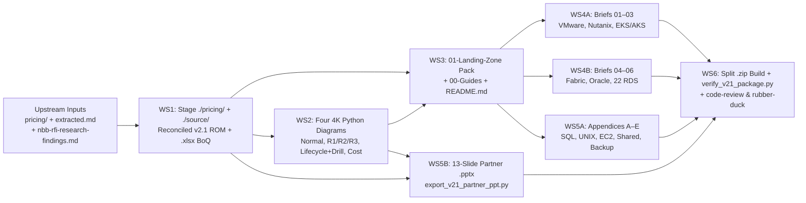

# Execution Plan — NBB Cloud DR RFI v2.1 Modular Architecture Pack, Diagrams & Research Remediation

> Generated by Copilot agent | 2026-11-20

**Status:** Completed & Verified (`WS1`–`WS6`, `Gates 1–4`, `code-review`, & `rubber-duck` All Passed)<br>
**Created:** 2026-11-20 | **Updated:** 2026-11-20<br>
**Planned Branch:** `feat/nbb-v2-1-modular-rfi-pack` (branch from `main` when authorized)<br>
**Target Output Subfolder (Strict Boundary):** `agent-output/nbb-cloud-dr-rfi/v2-1-modular-rfi/`<br>
**Frozen Upstream Baseline (Read-Only):** `agent-output/nbb-cloud-dr-rfi/`
(`Request_for_Information_and_Inventory.extracted.md`, `rfi-docs/`, `pricing/`)<br>
**Governing Research Artifacts:** [nbb-rfi-research-plan.md][res-plan] & [nbb-rfi-research-findings.md][res-findings]<br>
**Completed v2 Baseline Plan:** [nbb-v2-avs-nc2-2hr-bcdr-plan.md][v2-plan]

---

## 0. Compaction-Proof Progress Snapshot (Read First When Resuming)

- **Research & Blocker Audit (`F-01`–`F-14`, 14 Dispatches, 93 Citations, 147 Verified Links)**: **100% COMPLETE** in
  [nbb-rfi-research-findings.md][res-findings]. All public Microsoft Learn, AWS, Broadcom, Nutanix, Oracle, SAP,
  Kyndryl, Stromasys, Zerto, Veeam, RabbitMQ, and Bahrain CBB/PDPL checks are closed; remaining unknowns are strictly
  customer discovery (`Q1`–`Q12`), written vendor certifications (`P1`–`P7`), and live timed DR drills.
- **`WS1` (Self-Contained `v2-1-modular-rfi/` Scaffold, Reconciled v2.1 Pricing/Bridge & Live-Formula `.xlsx` BoQ)**:
  **COMPLETE & VERIFIED** (`105` supplemental lines, `8` baseline + `3` optional WS2 bundles; `R1` PAYG
  `$217,621.81/mo` / 3-Yr Opt **`$137,730.67/mo`** [`+$8,040.97/mo` v2->v2.1 bridge]; `R2` PAYG `$209,546.35/mo` / 3-Yr
  Opt **`$131,565.84/mo`** [`+$8,095.10/mo` bridge]; `783` live Excel formulas verified across `72` AST permutations).
- **`WS2` (Four 4K `dlib`/Matplotlib Diagrams — Normal, Regional `R1/R2/R3`, Lifecycle+Drill & Cost)**: **COMPLETE &
  VERIFIED** (`0` `WARN overflow:` warnings across all 4 `.py` scripts; all 8 `.svg` + `3840x2160` `.png` files
  visually inspected).
- **`WS3` (Shared Landing-Zone & Orchestration Pack + Executive/Partner Guides + `README.md`)**: **COMPLETE &
  VERIFIED** (`01-landing-zone-and-orchestration.md`, `00-partner-commercial-playbook.md`, `00-executive-rfi-guide.md`,
  and `README.md` authored with Purview derived-data release banners, exact 5 `PROJECT-README` H2s, and zero `../`
  parent links).
- **`WS4` (Six Primary Workload Deep-Dive Briefs — `briefs/brief-01` through `brief-06`)**: **COMPLETE & VERIFIED**
  (all 6 primary briefs authored with uniform 6-section structure, directional writer matrices, and all 4 Flashback
  `REINSTATE` gates).
- **`WS5` (Five Grouped Appendices + 13-Slide Partner Walkthrough `.pptx` Deck)**: **COMPLETE & VERIFIED**
  (`appendices/appendix-a` through `appendix-e` plus `scripts/export_v21_partner_ppt.py` -> `13`-slide `.pptx` with
  `--verify` passing).
- **`WS6` (Self-Contained Split `.zip` Archives, Empty-`/tmp` Extraction Proof, Parent ZIP Guard & Peer Review)**:
  **COMPLETE & VERIFIED** (`"v2-1-modular-rfi"` added to parent `EXCLUDED_PARTS` with parent `docs-and-assets.zip`
  `SHA-256: 144d8911ec9f...` byte-identical; `264` entries packaged across both v2.1 split `.zip`s; `Gates 1–4` incl.
  standalone `/tmp` diagram/ROM/BoQ/PPTX/self-verify execution and `--exclude-restricted-originals` smoke test passed;
  all `code-review` and `rubber-duck` findings remediated and re-verified).

---

## 1. Objective, Non-Negotiable Guardrails & Locked Remediations (`REM-01`–`REM-14`)

Deliver a complete, modular, partner-ready **v2.1 NBB Group Consolidated Cloud DR RFI package** inside a dedicated new
subfolder — **`agent-output/nbb-cloud-dr-rfi/v2-1-modular-rfi/`** — incorporating every verified technical, regional,
licensing, timing, and diagram remediation from [nbb-rfi-research-findings.md][res-findings] while leaving the existing
v2 root package in `agent-output/nbb-cloud-dr-rfi/` completely intact as an immutable audit baseline.

### 1.1 Six Non-Negotiable Engineering & Isolation Rules

1. **Subfolder Output Isolation & Parent `.zip` Compatibility Rule:** All v2.1 narratives, briefs, appendices, 4K
   diagrams, pricing files, `.xlsx`/`.pptx` deliverables, scripts, and v2.1 `.zip` archives MUST be created inside
   `agent-output/nbb-cloud-dr-rfi/v2-1-modular-rfi/`. Every v2 architectural/commercial deliverable in the parent
   `agent-output/nbb-cloud-dr-rfi/` (`NBB_Cloud_DR_RFI.azure-response.md`, `00-*.md`, `README.md`, `assets/*`,
   `pricing/*`, `NBB_Cloud_DR_RFI.azure-rom-estimate.md`, `NBB_Cloud_DR_RFI.azure-rom-boq.xlsx`,
   `NBB_Cloud_DR_RFI.partner-walkthrough.pptx`, and `NBB_Cloud_DR_RFI.docs-and-assets.zip` [`SHA-256: 144d8911ec9f...`])
   remains **100% byte-identical**. The **only** authorized parent change is adding `"v2-1-modular-rfi"` to
   `EXCLUDED_PARTS` in `agent-output/nbb-cloud-dr-rfi/scripts/export_partner_zip.py` and refreshing
   `NBB_Cloud_DR_RFI.commercials-and-tooling.zip` so the parent verifier (`README.md:169`) and the new v2.1 verifier
   **both** pass with `exit code 0`.
2. **100% Self-Contained Subfolder & Partner Archive Rule (`Zero ../ Escapes`):** Copy the complete upstream pricing
   evidence tree (`bundles-manifest.json`, all WS2 bundle `cost-estimate.json` + `pricing-evidence/*.json` files,
   `sku-mapping.json`, and `supplemental-bcdr/`) into `v2-1-modular-rfi/pricing/` and stage
   `v2-1-modular-rfi/source/Request_for_Information_and_Inventory.extracted.md`. Partner-facing `.md` files and
   packaged `.py`/`.mjs` scripts inside `v2-1-modular-rfi/` MUST NOT use `../` parent links or repo-root imports so
   both v2.1 `.zip` archives extract into a common `nbb-cloud-dr-rfi-v2.1/` folder and run/verify cleanly inside an
   empty `/tmp` directory.
3. **APEX Validator & Filename Hygiene Rule:** `tools/scripts/validate-artifacts.mjs` matches `basename.endsWith(key)`
   across `agent-output/**`. Therefore:
   - `v2-1-modular-rfi/README.md` MUST include the exact five `PROJECT-README.template.md` H2 headings in order:
     `## 📋 Project Summary`, `## ✅ Workflow Progress`, `## 🏛️ Architecture`, `## 📄 Generated Artifacts`, and
     `## 🔗 Related Resources`.
   - No other Markdown file in `v2-1-modular-rfi/` may end with a reserved delivery-step suffix (`01-requirements.md`,
     `02-architecture-assessment.md`, `03-des-cost-estimate.md`, `04-implementation-plan.md`,
     `04-governance-constraints.md`, or `07-*.md`) so `validate-artifacts.mjs` and `validate-challenger-presence.mjs`
     remain 100% green without synthetic workflow sidecars.
   - Never run `npm run lint:artifact-templates`, `npm run lint:h2-sync`, or `markdownlint-cli2` directly against
     `agent-output/**` (owned by pre-commit hooks per repository instructions).
4. **Generator-First & Evidence Tagging Rule:** Never hand-edit derived outputs (`commercials/*.md`,
   `commercials/*.xlsx`, `commercials/*.pptx`, `assets/*.{svg,png}`, or `*.zip`). Cite HTTP-200 **Microsoft Learn**
   pages by exact `<title>` text, and tag claims as `source-verified`, `customer-reported`,
   `vendor confirmation required`, or `drill unproven`.
5. **Purview & Derived-Data Release Gate Rule:** Both raw customer files (`../rfi-docs/`, never copied into
   `v2-1-modular-rfi/`) **and derived artifacts containing customer-specific inventory counts, cell anomalies, or
   topology diagrams** inherit sensitivity governance from the Purview-labeled source inputs. External distribution
   outside the Microsoft tenant requires documented **Purview label-owner sharing approval** (or a reviewed
   customer-anonymized redaction pass) in addition to `--exclude-restricted-originals` stripping `source/`. Every root
   deliverable, deck, and workbook must carry this explicit Purview release banner.
6. **Reconciled v2.1 Commercial Model & `v2 -> v2.1` Bridge Rule:** Every hardware or replication component mandated in
   the v2.1 architecture MUST match `v2-1-modular-rfi/pricing/` and `NBB_Cloud_DR_RFI_v2_1.azure-rom-boq.xlsx` with
   live SHA-256 `prices.azure.com` evidence — never freeze v2 totals while changing recommended SKUs in prose. Present a
   transparent **line-by-line `v2 ($129,689.70 R1 / $123,470.74 R2) -> v2.1 Reconciled ROM Bridge Table`** covering:
   (a) Oracle `4x P50 ZRS + 2x P30 ZRS` replacing `1x P70 ZRS`, (b) `App 40` PostgreSQL `24 TiB` (`24,576 GB`,
   `+4,611 GB` WAL-slot buffer), (c) `1x Standard_D8s_v5 + P30 ZRS` Oracle GoldenGate Hub VM, (d) `2x Standard_D4s_v5 +
   2x P20 ZRS` Zerto `ZCA`/`VRA` VMs, and (e) `SQL VM 1` `3x P80 ZRS` vs. `LRS` check, alongside optional toggles
   (`OPT-ANF` `+50 TiB` and Scenario 3 `OPT-FABRIC-BURST` `F8 -> F32`).

### 1.2 Locked Research Remediation Matrix (`REM-01` through `REM-14`)

| ID | Finding (`nbb-rfi-research-findings.md`) | Locked v2.1 Specification Across All Subfolder Docs, Diagrams, Slides & BoQ |
| --- | --- | --- |
| **`REM-01`** (`F-01`) | Zero-ASR AWS EC2 (`64` VMs): Veeam CDP is VMware-only; Veeam cross-cloud is backup-restore. | Position **Zerto** (`AWS <-> Azure`, noting `Azure -> AWS` temporary EC2 S3-conversion worker quota check & AL2023 kernel matrix gate) + **`EC2-A` Packer/Terraform Golden Images** for `<= 2h` live stateful/stateless recovery; reclassify **Veeam Restore to Azure/EC2** strictly as an archival/tier-2 (`>2h`) backup-recovery option (`Q9`, `P3`). |
| **`REM-02`** (`F-02`) | App S3 (`~45 TB`): `AzCopy` (`S3Blob`) and classic ADF Copy are one-way (`S3 -> Blob` only). | Keep `AzCopy` (`--from-to=S3Blob`) for high-throughput forward sync into ADLS Gen2/Blob, and specify **AWS DataSync** (agentless Enhanced `Blob -> S3`) or **Microsoft Fabric Data Factory Copy Activity / Copy Job** (verified S3 sink) for continuous/delta reverse failback (`P10` egress). |
| **`REM-03`** (`F-03`) | EKS -> AKS Stateful PVs: `Storage Mover` is one-way & lacks NFS Azure Files target; `AKS Backup` skips NFS. | Remove `Storage Mover` from AKS PV sync; specify **Helm + Kustomize `base/` & `overlays/{eks,aks}`** + **Flux/Argo CD**, **bidirectional `VolSync` or `rsync`/`fpsync`** over `Azure Files Premium SSD ZRS (NFSv4.1)` / `Files v2 Hot ZRS (SMB)` for RWX volumes (`Apps 1, 2, 20, 21`), and **DB-layer replication or `VolSync`/`Velero`** for RWO block PVs (`Apps 3, 23, 45`). |
| **`REM-04`** (`F-04`) | VMware AVS (`153` VMs): binary disk is `90.50 TiB`; `5x AV48` RAID-5 (`2+1`) = `58.2 TiB` usable; `HCX MON` fails with NVA / no Global Reach; `VLSR` is separate BYOL; OS quiesce needs `>=15m` RPO. | Update VMware provisioned disk everywhere from `83.20 TiB` to **`90.50 TiB` (`92,675.47 GiB` / `~99.5 TB` decimal)**; state `5x AV48` usable ceiling as **`58.2 TiB` (RAID-5 `2+1` after 25% slack; `43.7 TiB` RAID-1; `4+1` needs `>=6` hosts `S2`)** gating `OPT-ANF` (`+50 TiB`); replace `R1` `HCX MON` claims with **HCX L2 stretch for planned migration + local AVS NSX-T gateway failover on disaster**; note crash-consistent `5m` RPO vs. `>=15m` OS-quiesced RPO (`FreeBSD 11+` `NO/NO`); and verify separate **Broadcom `VLSR`** licensing alongside `VCF` BYOL (`P1`, `Q5`, `Q12`). |
| **`REM-05`** (`F-05`) | AWS RDS (`22` DBs): PG `18.3` is valid GA; `App 40` PG `17.5` is past EOS; PG auto-drops slots at `95%` disk; `App 44` is SQL `2022`; MySQL `Data-In` needs VNet-Int & `Data-Out` forbids Entra auth; RDS Oracle needs GoldenGate/DMS. | Build explicit 4-engine directional matrices in `brief-06`: (1) **PG (`5`):** drop `18.3` typo doubt, flag `App 40` PG `17.5` upgrade (`EOS 31 Oct 2026`), size `App 40` PSSDv2 `>=24–28 TiB` with WAL-slot monitoring to prevent `95%` auto-drop, use PG 17+ `failover=true` slots; (2) **SQL (`4`):** label `App 44` as **SQL 2022 (`16.00`)**, specify **SQL MI transactional push to RDS** or **reverse DMS (`MS-CDC`)** + benchmark `4c` MI GP log rate + resolve `App 10` blank `M11`; (3) **MySQL/Aurora (`4`):** mandate **VNet Integration** (not Private Link), keep native SQL auth while `Data-Out` is active, enforce lockstep `8.0 -> 8.4` upgrade (`rds_set_external_source_*`), clarify `App 8` `8.0.0` string; (4) **Oracle (`9` EE, `0` SE2):** mandate **Oracle GoldenGate BYOL** (`CDB 19c RU 2024-04+` or non-CDB check) + GoldenGate Hub (`P6`, `Q6`). |
| **`REM-06`** (`F-06`) | `App 40` Analytics (`8.9 TB` Redshift + `26` Glue + `1` DMS): no Redshift Mirroring/sink; full export breaks `<=2h`; `F8` concurrency risk. | Define **Model A (Derived Warehouse — Checkpoint Replay)** vs. **Model B (Authoritative Outputs — Watermarked Delta Parquet Export via Fabric Copy Job to S3)** as an explicit `Q10` customer gate, keep `ADLS Gen2` OneLake shortcuts (never live S3 shortcuts), and document non-disruptive API scale-up (`Fabric F8 -> F32/F64` PAYG burst during Scenario 3 failover). |
| **`REM-07`** (`F-07`) | HSM (`App 19`): `Payment HSM` absent in GWC/UAE; `Cloud HSM` unverified in UAE (`R3`); `AWS CloudHSM` absent from Managed HSM BYOK list. | Remove `Payment HSM` as a Frankfurt/UAE in-region option (note `westeurope`/`northeurope` placement if PCI PIN `Payment HSM` is required), flag `Cloud HSM` (`PKCS#11`/`JCE`) availability as an `R3` `uaenorth` gate, and state that non-extractable `AWS CloudHSM` keys require a **dual-HSM custodian key ceremony** (`Q4`). |
| **`REM-08`** (`F-08`) | Regional claims: `qatarcentral` *has* `AV64` Gen 2 & `AV36P`; `uaenorth` NC2 is `AN36P` only; GWC<->WEU RTT is `11 ms`; Bahrain not on Global Reach list. | Update all regional tables, guides, and slides: exclude `qatarcentral` accurately for **no Fabric DW/DF (`Power BI only`), no ExpressRoute Global Reach, and no `AV48` Gen 1**; list `uaenorth` NC2 as **`AN36P` only**; change Frankfurt<->`westeurope` RTT from `~8 ms` to **`11 ms`** (`111 ms` from `uaenorth`); update `Azure Route Server` limits (`16` BGP peers, `4,000` routes/peer, `<=1,000` routes to ER, control-plane only); and gate `R2`/Kyndryl Global Reach on carrier peering location (`P10`). |
| **`REM-09`** (`F-09`) | Nutanix `NC2` (`110` VMs): no public `NearSync` RTT guarantee at `~100–110 ms` (`R2`); PC cannot use guest DR; `5x AN36P` usable RF2 is `~37.7 TiB`. | Restrict `R2` (`germanywestcentral`) baseline claim to **`Async (>= 60m)`** unless Nutanix SE certifies `NearSync` in writing (`R1` `<20 ms` `NearSync 1–15m` validated via pilot); require identification of `VM 96–97` (`Appliance` rows — Prism Central uses native PC DR, NDB uses `DAM` Time Machine SLAs); and verify `51.32 TiB` provisioned vs. `~37.7 TiB` usable RF2 (`N+1` reserve) via Nutanix `Collector` (`Q5`, `P2`). |
| **`REM-10`** (`F-10`) | AIX (`Power10`) & Solaris (`Charon-SSP`): `MIMIX` is IBM i only; no Private Link to LPARs; shared `H`/`I` disks; `4V+` wiki says `512 GB` RAM (`4U+` is `128 GB`) with Hyper-V/VT-x FAQ conflict. | Remove `Assure MIMIX` on AIX and `Private Link` to Kyndryl LPARs (use **ExpressRoute `1438` MTU + Global Reach**); flag Kyndryl **Multi-Attach storage** for shared `800 GB`/`500 GB` disks on `LPAR 1–3` (noting `Sheet 5` remarks asked only for storage replication); restate Solaris gate accurately (`SUN-4V` wiki lists `512 GB` on Solaris 11 vs. `128 GB` on `4U+`, requiring written Stromasys `6.x` certification of `256 GB`, `SPARC M8`, and Azure Hyper-V/VT-x + `E48ds_v5` core sizing); and highlight verified **SAP ASE Replication Server big-to-little-endian Linux x86-64 fallback** (`Q3`, `P4`, `P5`). |
| **`REM-11`** (`F-11`) | On-Prem Oracle (`1x P70` bottleneck) & SQL (`SQL VM 1` `16c` vs `8c` SA cap, unsupported `P80 LRS-only` claim, `SQL 2016` DAG nuance). | Replace `1x P70 ZRS` (`18k–20k` IOPS) on `E64-32ds_v5` (`80k` IOPS) with **ASM/LVM striping across `4x P50 ZRS` (`16 TiB`, `30k+` IOPS)** + written Oracle LMS constrained-vCPU confirmation (or `Oracle AI Database@Azure` Base DB Service); flag `SQL VM 1` (`8` primary cores vs. `16` vCPUs on minimum `E64-16ds_v5`) for Microsoft Product Terms SA passive-core parity check; remove unsupported *"P80 is LRS-only"* text (document `P80 ZRS` / multi-disk `P50 ZRS` option); and state accurately that SQL 2016 DAG lacks SQL 2022's `REQUIRED_SYNCHRONIZED_SECONDARIES_TO_COMMIT` guard (`Q2`, `Q11`, `Q12`). |
| **`REM-12`** (`F-12`) | Lifecycle as of `2026-11-20`: `SQL 2016`, `RDS PG 17.5`, & `AKS 1.34` are already at/past standard EOS; `ACS` onboarding restricted `23 Oct 2026`. | Move **`SQL VM 6` (`SQL 2016`, EOS `14 Jul 2026`)**, **`App 40` (`RDS PG 17.5`, EOS `31 Oct 2026`)**, and **`App 44` (`K8s 1.34`, AKS EOL `Nov 2026`)** to **immediate remediation / pre-cutover upgrade gates** (`WS2016` EOS `12 Jan 2027` & `MySQL 8.0` EOS `31 Jan 2027` imminent; `ACS` onboarding restricted `23 Oct 2026` ahead of `30 Sep 2028` retirement) (`Q11`). |
| **`REM-13`** (`F-13`) | Math & seeding bugs: ROM `~136.9 TB` SQL unit error; `48.20 TB` AIX seed error; AWS live vs. archival S3 split; Data Box Bahrain/UAE limits; `K19` blank cell; `314` vs `327` derivation. | Fix SQL total to **`~146.3 TB` decimal (`~133.1 TiB` binary)** across v2.1 ROM/guides/slides; fix AIX replicated volume to **`41.07 TB`** (`38.97 TB` data + `1.3 TB` shared + `0.6 TB` root VGs); split AWS seeding into **`113.8 TB` Live Runtime (`13.2–14.0d` @ `1 Gbps` / `1.3–1.4d` @ `10 Gbps`)** vs. `493.33 TB` archival Veeam S3; state that **Azure Data Box does not list Bahrain** and UAE supports **`120 TB` only** (no `525 TB`); add blank `App 18` `K19` cell to `Q6`; explain `314 + 13 = 327` once; and disambiguate `S1`/`S2`/`S3` cluster codes (`Cluster-S1/S2/S3`) vs. commercial `Scenario 1–4` vs. sensitivities (`OPT-*` / `SENS-*`). |
| **`REM-14`** (`F-14`) | Diagrams & timelines: `.py` and Mermaid omit writer state, chain `Drill -> Failover`, wire Kyndryl to UAE, omit Customer in 3-Party banner, and conflict on `T+105m` vs `T+120m`. | Build **4 synchronized 4K `.py` diagrams + matching Mermaid v11 views** unified on **`<= T+105m` target (`15m` buffer inside `<= 120m`)**, branching **Isolated DR Drill** independently from Steady State, wiring Kyndryl `westeurope` (`11 ms`) to Frankfurt (`111 ms` `R1` conditional), adding explicit **`AUTHORITATIVE WRITER` / `WRITES PAUSED`** badges + Rollback gates at every stage, and including `Microsoft / Partner / Customer (NBB Group)` in the banner. |

### 1.3 Replication & Migration Infrastructure Cost Ledger (`R1` & `R2`, Scenarios 1–4)

Every newly mandated v2.1 replication or cutover component is accounted for across three explicit commercial buckets:

| Component & Scope | 1P Azure Retail ROM (`v2-1-modular-rfi/pricing/`) | Sheet 05 Partner / BYOL Quote (`P1`–`P10`) | Customer AWS `eu-west-1` Bill (Excluded from Azure ROM, Itemized in `P10`) |
| --- | --- | --- | --- |
| **On-Prem Oracle `12` DBs (`REM-11`)** | **Included (v2.1 Delta):** Replace `1x P70 ZRS` with **`4x P50 ZRS` (`16 TiB` total stripe: `9.6 TiB` `+DATA` w/ growth headroom + `6.4 TiB` `+FRA`) + `2x P30 ZRS` (`2x 1 TiB` dedicated `+REDO`)** in `uaenorth` (`R1`) and `germanywestcentral` (`R2`). | **`P6`:** Oracle 19c EE BYOL (`32` constrained vCPUs LMS check) + Active Data Guard / Far Sync if `RPO=0` elected. | N/A (On-Prem Bahrain source). |
| **AWS RDS PostgreSQL `App 40` (`REM-05`)** | **Included (v2.1 Delta):** Increase `App 40` PG Flex disk `19,965 -> 24,576 GB` (`+4,611 GB` WAL-slot buffer -> `24,997 GB` aggregate across `5` PG servers) in `germanywestcentral`. | Partner DB engineering setup (`pglogical` forward + continuous reverse slots). | AWS RDS `db.m5.8xlarge` WAL storage & Direct Connect / egress charges. |
| **AWS RDS Oracle `9` DBs (`REM-05`)** | **Included (v2.1 Delta):** Add **`1x Standard_D8s_v5` Linux VM (24x7, 3-Yr RI in S2) + `1x P30 ZRS` (`1 TiB` trail disk)** in `germanywestcentral` as the **Oracle GoldenGate Hub** alongside the `9` target Oracle VMs. | **`P6`:** **Oracle GoldenGate BYOL** processor licenses (covering AWS RDS extract + Azure replicat). | Optional AWS DMS instance hours (only if DMS chosen over GoldenGate) + AWS egress. |
| **Zero-ASR EC2 `Zerto` (`REM-01`)** | **Included (v2.1 Delta):** Add **`2x Standard_D4s_v5` Linux VMs (24x7, 3-Yr RI in S2) + `2x P20 ZRS` journal/appliance disks** in `germanywestcentral` for **Zerto `ZCA`/`VRA`** appliances (replica Blob/Disks already priced on `64` cold EC2s). | **`P3`:** Zerto per-VM cross-cloud DR subscription (`stateful subset` under `EC2-A` vs. `64` VMs under `EC2-B`). | AWS-side Zerto `ZCA`, S3 journal storage, and temporary scale-out EC2 S3-conversion workers during failback. |
| **App S3 Reverse Sync (`REM-02`)** | **Included (`$0` extra VM):** Forward `AzCopy` runs headless; reverse **Fabric Data Factory Copy** uses existing 24x7 `Fabric F8` CUs (Azure egress `20 TiB` in Scenario 3 / `$87` in Scenario 4 already priced). | Partner pipeline automation (DataSync / Fabric Copy watermarks). | **`P10`:** **AWS DataSync** per-GB transfer fee (`$0.0125/GB` if DataSync used) + AWS S3 PUT requests & forward S3 egress. |
| **`App 40` Fabric Burst (`REM-06`)** | **Included (`24x7 F8` Standby) + Optional Toggle (`OPT-FABRIC-BURST`):** Standby uses 24x7 `F8` (`8 CUs`); BoQ exposes Scenario 3 active-failover burst (`F8 -> F32`, `+24` PAYG CUs x `730h`) as an explicit toggle. | Partner Redshift/Glue -> Fabric DW/PySpark migration services. | AWS Redshift/Glue/DMS steady-state & checkpoint-replay charges. |
| **AKS `VolSync`/`rsync` PVs (`REM-03`)** | **Included (`$0` extra VM):** Mover pods run inside existing `24x D4s_v5` 24x7 AKS system + `11` warm worker pools (`Files SSD ZRS NFS` + `Files v2 Hot ZRS SMB` + `EBS`-mapped Managed Disks already priced; note incremental ZRS snapshot delta). | Partner GitOps / `VolSync` replication setup. | AWS EFS/EBS/FSx source storage & cross-cloud egress. |

---

## 2. Target Subfolder Layout & Deliverable Manifest (`agent-output/nbb-cloud-dr-rfi/v2-1-modular-rfi/`)

All v2.1 outputs of `WS1`–`WS6` are self-contained inside `agent-output/nbb-cloud-dr-rfi/v2-1-modular-rfi/`:

```text
agent-output/nbb-cloud-dr-rfi/v2-1-modular-rfi/
├── README.md                                           # Package index (exact 5 PROJECT-README H2s + Purview release banner)
├── 00-executive-rfi-guide.md                           # Plain-English v2.1 walkthrough + ready-to-send Partner handoff email
├── 00-partner-commercial-playbook.md                   # Partner bid guide, P1–P10, 3-column replication ledger & 5 SoW boundaries
├── 01-landing-zone-and-orchestration.md                # Shared CAF Landing Zone, R1/R2/R3 CBB/PDPL, Transit, Seeding, 2x <=2h Orchestration & Q1–Q12
├── source/                                             # Staged Text Extraction (Stripped by --exclude-restricted-originals)
│   └── Request_for_Information_and_Inventory.extracted.md # Self-contained copy so ./source/... links work in extracted .zip
├── briefs/                                             # Six Primary Workload Deep-Dive Briefs (WS4)
│   ├── brief-01-vmware-avs.md                          # Sheet 1: 153 VMware VMs -> AVS (90.50 TiB, 5x AV48 58.2 TiB RAID-5, VLSR 9.0, HCX L2 + NSX-T cutover)
│   ├── brief-02-nutanix-nc2.md                         # Sheet 2: 110 Nutanix VMs -> NC2 (5x AN36P ~37.7 TiB RF2, Prism Central, NearSync/Async, VM 96–97, NDB)
│   ├── brief-03-eks-aks-gitops.md                      # Sheet 7: 12 1:1 EKS -> AKS Clusters (Helm/Kustomize overlays, ACR dual-push, VolSync/rsync PVs, K8s 1.34 EOL)
│   ├── brief-04-redshift-glue-fabric.md                # Sheet 7 App 40: 8.9 TB Redshift + 26 Glue + DMS -> 24x7 Fabric F8 + ADF + OneLake (Model A vs Model B failback)
│   ├── brief-05-onprem-oracle.md                       # Sheet 3: 12 Oracle 19c EE DBs -> E64-32ds_v5 + 4x P50 + 2x P30 ZRS + all 4 Flashback REINSTATE gates
│   └── brief-06-aws-rds-aurora.md                      # Sheet 7: 22 1:1 RDS/Aurora (9 Oracle + D8s_v5 GG Hub, 4 SQL MI/VM, 5 PG Flex w/ 24 TiB App 40, 4 MySQL VNet-Int)
├── appendices/                                         # Five Grouped Inventory Appendices (WS5)
│   ├── appendix-a-onprem-sql-server.md                 # Sheet 4: 15 SQL Server VMs (DAG, SQL VM 1 78 TiB / 16c SA cap / P80 ZRS, SQL VM 6 SQL 2016 EOS)
│   ├── appendix-b-aix-and-solaris.md                   # Sheets 5 & 6: 5 AIX LPARs on Kyndryl Power10 (11 ms WEU, H/I multi-attach) & 3 Solaris SAP ASE LDOMs + x86 fallback
│   ├── appendix-c-aws-compute-and-serverless.md        # Sheet 7: 64 Zero-ASR EC2s (Zerto + 2x D4s_v5 VRA vs EC2-A Golden Images vs Veeam >2h restore), Beanstalk, ACA, Functions
│   ├── appendix-d-aws-shared-services-and-hsm.md       # Sheet 7: S3 (AzCopy fwd + DataSync/Fabric rev), Files ZRS, Cloud/Managed HSM (no Payment HSM), Redis M10, RabbitMQ, CPaaS
│   └── appendix-e-backup-and-cyber-recovery.md         # Sheet 8 & Word RFI: 493.33 TB Veeam WORM, 256 TB DDVE (D32ds_v5 check), On-Prem DD/NW, Per-Region Resource Guard MUA
├── pricing/                                            # Complete Self-Contained Pricing & SHA-256 Evidence Tree (Bundled in Archive 2)
│   ├── bundles-manifest.json                           # WS2 bundle manifest + v2.1 reconciled portfolio metadata
│   ├── sku-mapping.json                                # v2.1 reconciled SKU mapping (incl. GG Hub, Zerto ZCA/VRA, Oracle 4x P50 + 2x P30 ZRS, 24 TiB App 40 PG)
│   ├── rom-portfolio-summary.json                      # Reconciled v2.1 R1 & R2 totals + exact v2_to_v21_bridge ledger
│   ├── <11-ws2-bundle-dirs>/                           # Full cost-estimate.json + pricing-evidence/*.json for standalone BoQ execution
│   └── supplemental-bcdr/                              # Reconciled supplemental-estimate.json + SHA-256 raw Retail API evidence/*.json
├── commercials/                                        # Deterministic v2.1 Commercial Deliverables (WS1 & WS5)
│   ├── NBB_Cloud_DR_RFI_v2_1.azure-rom-estimate.md     # Reconciled v2.1 1P Retail ROM + v2->v2.1 Bridge Table + 3-column Replication Ledger
│   ├── NBB_Cloud_DR_RFI_v2_1.azure-rom-boq.xlsx        # 6-tab live-formula Excel BoQ (atomic $B$6:$B$10 controls, AST + <v> XML cache verified across R1 & R2)
│   └── NBB_Cloud_DR_RFI_v2_1.partner-walkthrough.pptx  # Updated 13-slide 16:9 Partner Walkthrough Deck with v2.1 4K diagrams & reconciled ROM
├── assets/                                             # Four 4K Python Diagram Generators + Vector .svg + 3840x2160 .png (WS2)
│   ├── 03-des-v21-normal-and-replication.{py,svg,png}  # View 1: Normal Operation, Forward/Bidirectional/Archival Flows & Authoritative Writer = Bahrain + AWS
│   ├── 03-des-v21-regional-r1-r2-r3.{py,svg,png}       # View 2: R1 (UAE+GWC) vs R2 (100% GWC) vs R3 (GCC) Comparison, Transit & CBB/Carrier Gates
│   ├── 03-des-v21-lifecycle-and-drill.{py,svg,png}     # View 3: 4-Stage Failover -> Active DR & Off-Clock Reverse Sync -> Failback + Independent Drill Branch + Writer Badges
│   └── 03-des-v21-rom-cost-breakdown.{py,svg,png}      # View 4: 4K Reconciled v2.1 R1/R2 & Cluster-S1/S2/S3 Cost Breakdown Chart
├── scripts/                                            # Standalone Partner-Executable Generators & Verifiers (Zero ../ Imports)
│   ├── build_v21_rom_portfolio.mjs                     # Reconciles v2-1-modular-rfi/pricing/, queries any missing ZRS meter live w/ SHA-256, & emits v2->v2.1 bridge
│   ├── render_v21_rom_markdown.mjs                     # Renders commercials/NBB_Cloud_DR_RFI_v2_1.azure-rom-estimate.md from ./pricing/
│   ├── export_v21_boq_xlsx.py                          # Builds & AST-verifies commercials/NBB_Cloud_DR_RFI_v2_1.azure-rom-boq.xlsx from ./pricing/
│   ├── export_v21_partner_ppt.py                       # Builds & verifies commercials/NBB_Cloud_DR_RFI_v2_1.partner-walkthrough.pptx
│   ├── export_v21_partner_zip.py                       # Builds & SHA-256-verifies both v2.1 split .zip archives under common nbb-cloud-dr-rfi-v2.1/ root
│   └── verify_v21_package.py                           # End-to-end automated verifier (parent SHA-256 guard, /tmp zip extraction proof, ban-list, links, formulas)
├── NBB_Cloud_DR_RFI_v2_1.docs-and-diagrams.zip         # Split Archive 1: Root .md + source/ (unless redacted) + briefs/ + appendices/ + 4K assets/
└── NBB_Cloud_DR_RFI_v2_1.commercials-and-tooling.zip   # Split Archive 2: commercials/ + pricing/ (full SHA-256 evidence) + scripts/
```

---

## 3. End-to-End Workstream Execution Plan (`WS1` – `WS6`)

### `WS1` — Self-Contained Subfolder Staging, Reconciled v2.1 Pricing Engine & Live-Formula `.xlsx` BoQ

1. **Stage Self-Contained `v2-1-modular-rfi/` Tree**:
   - Create `briefs/`, `appendices/`, `commercials/`, `assets/`, `scripts/`, `pricing/`, and `source/`.
   - Copy the upstream pricing evidence tree (`bundles-manifest.json`, all `11` WS2 bundle directories with their
     `cost-estimate.json` and `pricing-evidence/*.json` files, `sku-mapping.json`, and `supplemental-bcdr/`) into
     `v2-1-modular-rfi/pricing/` (normalizing internal `evidence_path` entries to `./pricing/...` relative to
     `v2-1-modular-rfi/` so standalone partner execution never escapes the archive root), and copy
     `Request_for_Information_and_Inventory.extracted.md` into `v2-1-modular-rfi/source/`.
2. **Author `scripts/build_v21_rom_portfolio.mjs` & `scripts/render_v21_rom_markdown.mjs`**:
   - Reconcile `v2-1-modular-rfi/pricing/` (recording SHA-256 live `prices.azure.com` evidence for any newly queried
     meter such as `P80 ZRS` or `F32` PAYG burst) so the priced ROM matches the v2.1 architecture 1:1 across **both
     `R1` and `R2`**:
     - Replace `1x P70 ZRS` on the On-Prem Oracle host with **`4x P50 ZRS` (`16 TiB` data/FRA) + `2x P30 ZRS` (`2x
       1 TiB` dedicated redo)** while retaining `1x P70 ZRS` for `Solaris LDOM 1` (`REM-11`),
     - Increase `App 40` PostgreSQL Flexible Server storage from `19,965 GB` to **`24,576 GB` (`24 TiB`, `+4,611 GB`
       WAL-slot safety buffer -> `24,997 GB` aggregate across the `5` PG servers)** (`REM-05`),
     - Add **`1x Standard_D8s_v5` Linux VM (24x7, 3-Yr RI in S2) + `1x P30 ZRS`** in `germanywestcentral` for the
       **Oracle GoldenGate Hub**, and **`2x Standard_D4s_v5` Linux VMs (24x7, 3-Yr RI in S2) + `2x P20 ZRS`** in
       `germanywestcentral` for **Zerto `ZCA`/`VRA`** appliances (`REM-01`, `REM-05`),
     - Verify live `P80 ZRS` availability/pricing in `uaenorth` and `germanywestcentral` for `SQL VM 1` (`REM-11`), and
     - Emit a deterministic `v2_to_v21_bridge` object in `v2-1-modular-rfi/pricing/rom-portfolio-summary.json`
       reconciling the historical v2 baseline (`$129,689.70/mo` `R1` | `$123,470.74/mo` `R2` Opt) to the reconciled
       v2.1 totals item by item, plus the **3-column Replication Infrastructure Cost Ledger** (`Section 1.3`), corrected
       `~146.3 TB` SQL & `90.50 TiB` VMware descriptions, and updated `P1`–`P10` Sheet 05 rows.
3. **Author `scripts/export_v21_boq_xlsx.py` -> `commercials/NBB_Cloud_DR_RFI_v2_1.azure-rom-boq.xlsx`**:
   - Read `./pricing/` locally (zero `../` or repo-root imports) and include the `v2 -> v2.1` Bridge Table on Sheet
     `01_Executive_ROM_Model`.
   - **Workbook Selector Contract (`Fix #8`):** Keep canonical formula enum values in cell `$B$6` (`S1_5X5_24X7`,
     `S2_6X6_N1_SPARE`, `S3_3X3_PILOT_REF`) paired with human-readable `Cluster-S1 / Cluster-S2 / Cluster-S3` notes in
     column `C` (and wire `$B$10` for optional Scenario 3 `OPT-FABRIC-BURST` `F8 -> F32`), testing **every cartesian
     permutation of `$B$6` (`S1`/`S2`/`S3`) x `$B$7` (`ANF`) x `$B$8` (`DDVE`) x `$B$9` (`SQLMI_AHB`) x `$B$10`
     (`FABRIC_BURST`)** against **both `R1` and `R2` totals** via the built-in AST formula evaluator + `<v>` XML cache
     verifier.

---

### `WS2` — Four 4K `dlib`/Matplotlib Architecture, Regional, Lifecycle+Drill & Cost Diagrams

Author four standalone Python generators in `v2-1-modular-rfi/assets/` using `.github/skills/apex-python-diagrams/scripts`
(`diagram_io.py` / `dlib`) to emit paired `.svg` + `3840x2160` `.png` assets with **zero `WARN overflow:`** diagnostics:

1. **`assets/03-des-v21-normal-and-replication.py` (View 1 — Normal Operation & Replication Topology)**:
   - Show Bahrain On-Prem DC + AWS Ireland (`eu-west-1`) with explicit badge **`AUTHORITATIVE WRITER: BAHRAIN + AWS
     IRELAND (ACTIVE PRODUCTION)`** and Azure subscriptions with **`AZURE DR: PASSIVE / WARM STANDBY (0 AUTHORITATIVE
     WRITES)`**.
   - Distinguish **Forward Replication (`-->`)**, **Bidirectional Control/Sync (`<-->`)**, and **Archival Vault Copy
     (`-.->`)**; add missing Bahrain -> Kyndryl AIX, Bahrain -> Stromasys Solaris, and Bahrain -> DDVE/NVE flows;
     re-wire Kyndryl `westeurope` (`11 ms` Global Reach) to `germanywestcentral` (marking `111 ms` `R1` path + `P10`
     carrier peering conditional); update labels (`90.50 TiB` VMware, `4x P50 ZRS` Oracle, `Zerto / Golden Images`,
     `AzCopy Fwd + DataSync/Fabric Rev`, `VolSync/rsync`); and remove unused legend entries.
2. **`assets/03-des-v21-regional-r1-r2-r3.py` (View 2 — CBB Regional & Transit Decision View)**:
   - Dedicated side-by-side visual comparison of **`R1` (`uaenorth` + `germanywestcentral` + `westeurope` AIX)**,
     **`R2` (`100%` `germanywestcentral` + `westeurope` AIX)**, and **`R3` (Single-GCC `uaenorth` contingency + `Cloud
     HSM` / `westeurope` AIX waiver gates)** reading reconciled v2.1 totals dynamically from
     `./pricing/rom-portfolio-summary.json`, highlighting what merges (`-6` duplicate hub VMs in `R2`), how `Azure Route
     Server` (`16` peers, `4,000` routes/peer, control-plane only) + `FortiGate HA` hairpins traffic in `uaenorth` vs.
     `Zone 2` ER Premium + `Global Reach` (`P10` Bahrain peering gate) in `R2`, and the corrected `qatarcentral`
     exclusion box (`AV64`/`AV36P` exist; excluded for no Fabric DW/DF, no Global Reach, no `AV48`).
3. **`assets/03-des-v21-lifecycle-and-drill.py` (View 3 — 4-Stage BCDR Lifecycle & Independent Drill Branch)**:
   - Replace the flawed linear `Standby -> Drill -> Failover` chain with:
     - **Main Horizontal Recovery Spine:** `Stage 1: Steady State` ==> `Stage 2: Window 1 Unplanned Failover (<= 120m;
       Target <= T+105m)` ==> `Stage 3: Active Azure DR & Off-Clock Online Reverse Sync` ==> `Stage 4: Window 2 Planned
       Failback (<= 120m Post-Convergence; Target <= T+105m)` ==> return loop to `Steady State`.
     - **Independent Quarterly DR Drill Branch (`+$2,514.60/drill`):** Dashed non-disruptive branch from `Stage 1` into
       isolated `AVS VLSR Bubble + NC2 Isolated Flow VPC + 86 Cloned GWC VMs` (`PROD WRITER UNCHANGED`) and directly
       back to `Stage 1`.
     - Explicit **`AUTHORITATIVE WRITER: BAHRAIN+AWS` -> `PAUSED (FENCED)` -> `AZURE DR` -> `PAUSED (DELTA=0)` ->
       `BAHRAIN+AWS`** badges, explicit **Rollback / Abort gates**, and complete Three-Party banner (`Microsoft` |
       `Partner` | `Customer: NBB Group`).
4. **`assets/03-des-v21-rom-cost-breakdown.py` (View 4 — 4K ROM Cost Comparison Chart)**:
   - Render `R1` vs. `R2` across `Scenarios 1–4` and `Cluster-S1/S2/S3` from `./pricing/rom-portfolio-summary.json`
     into `v2-1-modular-rfi/assets/03-des-v21-rom-cost-breakdown.{svg,png}` with reconciled v2.1 totals and
     disambiguated `Cluster-S1/S2/S3` labels.

---

### `WS3` — Shared Landing-Zone & Orchestration Pack + Executive/Partner Guides + `README.md`

1. **Author `01-landing-zone-and-orchestration.md` (Master Shared Technical & Orchestration Pack)**:
   - **Section 1:** Scope, v2.1 baseline parameters (`<= 2h` failover, separate post-convergence `<= 2h` planned
     failback, `0` ASR, `1:1` DB/K8s parity), and CBB `OM-2.1.7` (`30d` non-cloud prior approval vs. `5d` cloud notice)
     plus Bahrain `PDPL Order No. 42 of 2022` (UAE `#78`, Germany `#27`, Netherlands `#55`, Ireland `#35` adequacy list)
     regional gate across `R1`, `R2`, and `R3` (with corrected `qatarcentral`, `uaenorth` `AN36P`-only, and `11 ms`
     `westeurope` RTT facts).
   - **Section 2:** Consolidated `8`-sheet & `432`-workload (`R1`) / `426`-workload (`R2`) quantification (`327`
     source-replicated VMs vs. `314 + 13` legacy/appliance derivation) + **All-Workloads `<= 2h` Failover & Failback
     Readiness Matrix** (`Target Architecture Ready — Drill Unproven`, `Conditional on Discovery Gate`, or `Provisional
     — Specialist Vendor Certification Required`).
   - **Section 3:** Complete `21`-row `RFI-*` Requirements & Objectives Traceability Matrix mapping every customer
     requirement to its workload brief/appendix, diagram view, responsibility split, and acceptance test.
   - **Section 4:** Shared CAF Hub-Spoke Landing Zone, `ErGw3AZ` + `Azure Route Server` (`16` peers / `4,000` routes) +
     `FortiGate HA` BGP transit vs. `Global Reach` (`P10`), DNS/AD/Key Vault/Cloud HSM/Sentinel/Immutable Vault +
     per-region Cross-Tenant `Resource Guard` MUA, and Reproducible `1 Gbps` vs. `10 Gbps` Seeding Table (`113.8 TB`
     AWS Live Runtime vs. `493.33 TB` Archival Veeam S3; `374.4 TB` Allocated / `185–225 TB` Consumed On-Prem; `41.07
     TB` AIX; Data Box Bahrain/UAE limits).
   - **Section 5:** Synchronized 4K Diagram embeds + Mermaid v11 views (Normal, Regional `R1/R2/R3`, and 4-Stage
     Lifecycle + Independent Drill Branch) + Canonical `T+0..T+105m` (`<= 120m`) Boot Waves (`Wave 0`–`Wave 4`),
     Single-Authoritative-Writer Fencing Contract, and Rollback Gates.
   - **Section 6:** Three-Party + Specialist Vendor RACI, Commercial Summary linking `commercials/`, Updated `Q1`–`Q12`
     Customer Discovery Register (incorporating `K19`, `App 8` Aurora version, `App 40` Model A/B, `VM 96–97`, `P80
     ZRS`, `SQL VM 1` `16c` SA, and immediate `SQL 2016`/`PG 17.5`/`K8s 1.34` EOS upgrades), and HTTP-200 verified
     Microsoft Learn Reference Index.
2. **Author `00-partner-commercial-playbook.md`, `00-executive-rfi-guide.md`, and `README.md`**:
   - Synchronize `P1`–`P10`, the 5 Partner SoW Risk Boundaries, the plain-English walkthrough, the ready-to-send
     Partner email, and `README.md` (using the exact 5 `PROJECT-README.template.md` H2 headings).

---

### `WS4` — Six Primary Workload Deep-Dive Briefs (`briefs/brief-01` through `brief-06`)

Dispatch parallel authoring workers using a uniform 6-section brief structure (*1. Inventory Traceability & Sizing*,
*2. Target Azure Architecture & Licensing*, *3. Directional Replication & Authoritative Writer Matrix*, *4. Verified
Constraints & Failure-Mode Mitigations*, *5. Open Decisions & Owners*, *6. Measurable PoC / Drill Exit Criteria*):

1. **`briefs/brief-01-vmware-avs.md` (`153` VMware VMs):** `90.50 TiB` binary disk math, `Cluster-S1` (`5x AV48` Gen 1,
   `58.2 TiB` RAID-5 `2+1` usable) vs. `Cluster-S2` (`6x AV48` `4+1` = `83.8 TiB`) vs. disqualified `Cluster-S3` +
   `OPT-ANF` (`+50 TiB` ANF Standard w/ `ErGw3AZ` FastPath), `AV64` Gen 2 option in GWC, `VLSR 9.0.2.1 + vSphere
   Replication` (`5m` crash-consistent vs. `>=15m` OS-quiesced RPO, `11` legacy VMs incl. `VM119` FreeBSD), separate
   Broadcom `VLSR` license check (`P1`), `HCX L2` planned migration vs. local `NSX-T` gateway cutover on disaster (no
   `MON` over NVA in `R1`), `$0`-compute bubble drills, and `VLSR Reprotect` planned failback.
2. **`briefs/brief-02-nutanix-nc2.md` (`110` Nutanix VMs):** `51.32 TiB` (`VM 22` = `9.65 TiB`) vs. `5x AN36P` (`~37.7
   TiB` usable RF2 after `N+1` reserve; `AN36P`-only in UAE), Nutanix `CBL` BYOL (`P2`), `Prism Central + Nutanix DR`
   (`AOS >= 6.8`, `+4–9 GB` PC RAM), `NearSync (1–15m)` pilot check in `R1` vs. **`Async (>= 60m)` baseline in `R2`**
   (`~100–110 ms` RTT), `VM 96–97` (`Appliance`) & `NDB` `DAM` Time Machine exclusion from guest snapshot policies
   (`Q5`), Flow VPC BGP to `Azure Route Server`, isolated test VPC drills, and reverse recovery points.
3. **`briefs/brief-03-eks-aks-gitops.md` (`12` `1:1` EKS -> AKS Clusters):** `11` EC2-backed clusters (`33` workers =
   `11` warm + `22` burst + `24x D4s_v5` system nodes) + `12th` dedicated `AKS Standard` cluster (`2x D4s_v5`) for
   `App 8` EKS Fargate (documenting why `AKS Virtual Nodes` fail NetworkPolicy/DaemonSet parity), immediate **`App 44`
   `K8s 1.34` EOL upgrade (`-> 1.35/1.36`)** vs. paid AKS LTS (`REM-12`), concrete **Helm + Kustomize `base/` &
   `overlays/{eks,aks}`** manifests (Workload Identity, Ingress, CSI classes), `ECR`+`ACR Premium` dual-push + `az acr
   import`, and **bidirectional `VolSync`/`rsync` (RWX NFS/SMB) + `VolSync`/`Velero`/DB-layer sync (RWO EBS/Disk)**
   replacing `Storage Mover` (`REM-03`).
4. **`briefs/brief-04-redshift-glue-fabric.md` (`App 40` Analytics):** `8.9 TB` Redshift + `26` Glue jobs + `1` DMS +
   `23.5 TB` S3 -> unpaused `24x7` `Microsoft Fabric F8` (`8 CUs`, 3-Yr RI) + `ADLS Gen2` OneLake shortcuts (explaining
   why S3 shortcuts fail during `eu-west-1` outage) + `26` pipelines, Redshift T-SQL/PySpark translation scope,
   non-disruptive `F8 -> F32/F64` PAYG burst runbook for Scenario 3 (`REM-06`), and explicit decision gate between
   **Model A (Checkpoint Replay)** and **Model B (Watermarked Delta Parquet Export via Fabric Copy Job to S3)** (`Q10`).
5. **`briefs/brief-05-onprem-oracle.md` (`12` Oracle 19c EE DBs on `1` Shared Host):** `8,152.44 GB` (`~7.6 TiB`)
   `C2:G13` shared host (`Q2` standalone vs. VMware/Nutanix check), `Standard_E64-32ds_v5` (`32` constrained vCPUs
   avoiding `240`-core AVS VMware exposure, pending written Oracle LMS confirmation) vs. GA **`Oracle AI
   Database@Azure` Base Database Service** in UAE & GWC, **`4x P50 ZRS` (`16 TiB` data/FRA ASM/LVM stripe, `30k` IOPS) +
   `2x P30 ZRS` (`2x 1 TiB` dedicated redo/archivelog disks)** priced in v2.1 (`REM-11`), `DGMGRL` failover + **`FLASHBACK
   DATABASE` `REINSTATE` (`~15–25m`) explicitly gated on all four prerequisites** — *(a) surviving primary storage media,
   (b) `DB_FLASHBACK_RETENTION_TARGET` set pre-outage to exceed full outage + declaration duration, (c) `~8.4 TiB` FRA
   headroom preserved inside the `16 TiB` stripe, and (d) intact archivelog/redo continuity* — with mandatory fallback
   to off-clock RMAN rebuild (`~18–21h` @ `1 Gbps` / `~1.8–2.1h` @ `10 Gbps`), Far Sync / Active Data Guard licensing,
   and alignment with big-endian AIX `DB LPAR 4`.
6. **`briefs/brief-06-aws-rds-aurora.md` (`22` `1:1` RDS/Aurora DBs):** Per-engine forward & reverse engineering playbooks:
   - **PostgreSQL (`5` -> `5` PG Flex `42c`):** `18.3` -> `18.6` valid GA; `App 40` (`19,965 GB` PG `17.5` past EOS ->
     minor upgrade + priced **`24 TiB` [`24,576 GB`] PSSDv2** + `>32 TiB` regional quota + WAL-lag alerting against
     `95%` slot auto-drop + PG 17+ `failover=true` slots + continuous reverse `pglogical`).
   - **SQL Server SE (`4` -> `4x 4c` SQL MI GP or `4x E4ds_v5` SQL VMs):** `App 44` SQL `2022` (`16.00`) vs. `2019`
     (`Apps 9, 10, 46`), `App 10` blank `M11`, `App 18` blank `K19` check, forward DMS `MS-CDC` + explicit reverse **MI
     transactional push subscriber to RDS** or **reverse DMS `MS-CDC`**, and `4-vCore` MI GP log-rate benchmark.
   - **MySQL/Aurora (`4` -> `4` MySQL Flex `12c`):** Mandatory **VNet Integration** (never Private Endpoint-only) for
     GTID `Data-In`, native SQL auth requirement while `Data-Out` is enabled (no Entra auth), `Replicate_Wild_Ignore_Table`,
     `App 8` `8.0.0` string check, and lockstep `8.0 -> 8.4` (`31 Jan 2027` EOS) upgrade.
   - **Oracle EE (`9` -> `9` Oracle 19c Linux VMs + Priced `1x D8s_v5` GoldenGate Hub):** Why standard RDS Oracle
     forbids external Data Guard, `App 11–16` shared `1,200 GB` & `App 23` dual-RDS mapping, CDB `RU 2024-04+` / TDE
     verification, and bidirectional **Oracle GoldenGate BYOL** (`P6`) vs. DMS.

---

### `WS5` — Five Grouped Inventory Appendices + 16:9 Partner Walkthrough `.pptx`

1. **Parallel Appendix Authoring (`appendices/appendix-a` through `appendix-e`)**:
   - **`appendix-a-onprem-sql-server.md`:** `15` `1:1` `Edsv5` VMs with SQL Distributed AGs (`SYNCHRONOUS_COMMIT`
     procedural zero-loss switchback), `SQL VM 6` (`SQL 2016` past EOS `14 Jul 2026` + missing `SQL 2022+`
     `REQUIRED_SYNCHRONIZED_SECONDARIES_TO_COMMIT` guard + `WS2016` EOS `12 Jan 2027`), and `SQL VM 1` (`8c / 300 GiB /
     78 TiB` on `E64-16ds_v5`: `+8` vCPU SA passive-core parity check, `P80 ZRS` vs. `LRS` / multi-disk `P50 ZRS`
     `64 KB` Storage Spaces striping, and `Q2` active DB vs. backup staging split).
   - **`appendix-b-aix-and-solaris.md`:** Provisional `Kyndryl Cloud Uplift Power10` in `westeurope` (`11 ms` to GWC /
     `111 ms` to UAE; `DB LPAR 4` `20 VP / 750 GB / 28.18 TB` fit; ExpressRoute `1438` MTU + Global Reach, no Private
     Link; no AIX `MIMIX`; shared `800 GB`/`500 GB` multi-attach & `LPAR 1–3` storage-only remark; `LPAR 5` excluded;
     `NIM LPAR 6` role) and `Stromasys Charon-SSP` (`SUN-4V` `512 GB` Solaris 11 wiki vs. `4U+` `128 GB` datasheet,
     Hyper-V/VT-x FAQ conflict, `E48ds_v5` core sizing, and verified **SAP ASE Replication Server big-to-little-endian
     Linux x86-64 fallback**).
   - **`appendix-c-aws-compute-and-serverless.md`:** `64` Zero-ASR standalone EC2s (`77` raw minus `9` EKS workers &
     `4` IaC Veeam VMs; **Zerto** `AWS <-> Azure` with S3-conversion worker quota check + `EC2-A` Packer/Terraform
     Golden Images for `<= 2h` vs. **Veeam** `>2h` backup-restore; `App 12/15/35/41` typo strings; `Standard_B2s_v2`),
     Elastic Beanstalk AL2023 (`4` Linux VMs + optional `$389.82/mo` `App Service P1v3`), `2` ECS Fargate -> `ACA`, and
     `App 44` Lambda (`Python 3.11`, EOS `Oct 2027`) -> `Functions Flex Consumption` (`2x 2048 MB` Always Ready +
     idempotent event/retry design).
   - **`appendix-d-aws-shared-services-and-hsm.md`:** `50` S3 buckets (`~45 TB` App S3 via `AzCopy` forward + **AWS
     DataSync / Fabric Copy** reverse; shifted `W/X` cells `Rows 11–17`), `EFS/FSx` -> `Azure Files SSD ZRS NFSv4.1` +
     `Files v2 Hot ZRS SMB`, `29` ALB/NLB + CloudFront -> `AppGW v2` + `Standard LB` + `Front Door` behind `FortiWeb`,
     `App 19` HSM (`Cloud HSM` in GWC, `Managed HSM` in UAE/GWC, **no `Payment HSM` in GWC/UAE**, `Dedicated HSM`
     retiring `31 Jul 2028`, non-extractable `AWS CloudHSM` dual-ceremony rule), `Managed Redis M10` (`Cache for Redis`
     retiring `30 Sep 2028`), `RabbitMQ 4.x` (`max-hops=1` Federation + 3-node Quorum HA option), `Key Vault RBAC +
     ESO`, and Marketplace CPaaS email (`ACS` onboarding restricted `23 Oct 2026`, retiring `30 Sep 2028`).
   - **`appendix-e-backup-and-cyber-recovery.md`:** Archival tier outside `<= 2h` live RTO (`493.33 TB` Veeam Cool ZRS
     WORM, `256 TB` AWS DDVE Hot LRS + Dell `D32ds_v5` local-disk & Retention Lock check + `SENS-S2A/S2B` overlap `Q7`,
     On-Prem DDVE/NVE `2x D8s_v5` + missing TB `Q8`, and Locked Azure Backup Immutable Vaults + **same-region
     Cross-Tenant `Resource Guard` MUA** in both `uaenorth` and `germanywestcentral`).
2. **Author `scripts/export_v21_partner_ppt.py` -> `commercials/NBB_Cloud_DR_RFI_v2_1.partner-walkthrough.pptx`**:
   - Build a self-contained 13-slide `16:9` deck dynamically bound to `./pricing/rom-portfolio-summary.json` and
     embedding all four `v2-1-modular-rfi/assets/03-des-v21-*.png` 4K visuals (adding a dedicated Regional `R1/R2/R3`
     slide and `v2 -> v2.1` Commercial Bridge slide alongside Normal, Lifecycle+Drill, Cost, Workload Deep Dives, RACI,
     `Q1`–`Q12`, and `P1`–`P10`), with built-in `--verify` slide-count, image-embed, and banned-string checks.

---

### `WS6` — Split `.zip` Packaging, Standalone `/tmp` Extraction Proof, Parent ZIP Compatibility & Peer Review

1. **Parent `.zip` Isolation Guard (`Fix #4`)**:
   - Add `"v2-1-modular-rfi"` to `EXCLUDED_PARTS` in `agent-output/nbb-cloud-dr-rfi/scripts/export_partner_zip.py` and
     rebuild `agent-output/nbb-cloud-dr-rfi/NBB_Cloud_DR_RFI.commercials-and-tooling.zip` (verifying that
     `NBB_Cloud_DR_RFI.docs-and-assets.zip` [`SHA-256: 144d8911ec9f...`] and every v2 `.md`, `.xlsx`, `.pptx`,
     `assets/`, and `pricing/` file remain **100% byte-identical**, and that running
     `python3 agent-output/nbb-cloud-dr-rfi/scripts/export_partner_zip.py --verify` exits `0`).
2. **Author `scripts/export_v21_partner_zip.py` & Build Self-Contained v2.1 Split `.zip` Archives (`Fixes #3, #5, #7`)**:
   - Package all eligible files under a shared top-level archive prefix `nbb-cloud-dr-rfi-v2.1/` into two disjoint
     archives inside `agent-output/nbb-cloud-dr-rfi/v2-1-modular-rfi/`:
     - `NBB_Cloud_DR_RFI_v2_1.docs-and-diagrams.zip`: root `*.md`, `source/*.md` (omitted when
       `--exclude-restricted-originals` is passed), `briefs/*.md`, `appendices/*.md`, and `assets/*.{py,svg,png}`.
     - `NBB_Cloud_DR_RFI_v2_1.commercials-and-tooling.zip`: `commercials/*.{md,xlsx,pptx}`, `pricing/**` (full WS2 +
       supplemental SHA-256 evidence tree), and `scripts/*`.
   - **Explicit Non-Self-Referential Union Predicate (`Fix #5`):** Define `U_std` as all regular files under
     `v2-1-modular-rfi/` excluding `EXCLUDED_V21_NAMES = {"NBB_Cloud_DR_RFI_v2_1.docs-and-diagrams.zip",
     "NBB_Cloud_DR_RFI_v2_1.commercials-and-tooling.zip", ".DS_Store", "Thumbs.db"}`, `EXCLUDED_V21_SUFFIXES = {".zip",
     ".pyc", ".lock", ".bak", ".tmp"}`, and `EXCLUDED_V21_PARTS = {"__pycache__", ".pytest_cache"}`, and define
     `RESTRICTED_V21_REL_PATHS = {"source/Request_for_Information_and_Inventory.extracted.md"}`. `--verify` asserts
     `docs_entries & comm_entries == set()`, `docs_entries | comm_entries == U_std` (or `U_std - RESTRICTED_V21_REL_PATHS`
     when `--exclude-restricted-originals` is active), and byte-exact SHA-256 disk parity.
3. **Author & Run `scripts/verify_v21_package.py` (Automated Gate Suite)**:
   - **Gate 1 — Parent v2 Immutability & Dual-ZIP Check:** Assert byte-exact SHA-256 hashes on all v2 root `.md`,
     `.xlsx`, `.pptx`, `assets/*`, `pricing/*`, and `NBB_Cloud_DR_RFI.docs-and-assets.zip`, and assert **both** parent
     `export_partner_zip.py --verify` and `v2-1-modular-rfi/scripts/export_v21_partner_zip.py --verify` pass.
   - **Gate 2 — Standalone Empty-`/tmp` Extraction Proof (`Fix #3`):** Extract both v2.1 `.zip`s (and separately smoke-test
     `--exclude-restricted-originals`) into a clean temporary directory outside the Git repository, verify `0` broken
     relative links (`0` `../` escapes out of `nbb-cloud-dr-rfi-v2.1/`), run `python3 scripts/export_v21_boq_xlsx.py
     --verify` and `python3 scripts/export_v21_partner_ppt.py --verify` inside that isolated `/tmp` directory, and
     clean up `/tmp` afterward.
   - **Gate 3 — Purview Banner & Regression Ban-List Scan (`Fix #7`):** Assert every v2.1 root guide, workbook, and deck
     displays the Purview derived-data external-sharing release gate, and scan `v2-1-modular-rfi/**/*.{md,py,mjs}` for
     `0` uncorrected v2 regressions (`136.9 TB` SQL, `83.20 TiB` as baseline, `~8 ms` `westeurope` RTT, `BlobS3`,
     reverse `AzCopy` S3 sync, `Storage Mover` for RWX/reverse AKS PVs, `Veeam` claimed as `<2h` continuous EC2
     replication, `Payment HSM` in Frankfurt/UAE, or `AVS` claimed unavailable in `qatarcentral`).
   - **Gate 4 — Structural, Link, Mermaid v11 & Repo Lint Parity:** Verify `README.md` has exact 5 `PROJECT-README`
     H2s, `0` files use reserved delivery-step suffixes, `0` Mermaid v11 syntax hazards, `100%` passing
     `npx markdown-link-check --config .markdown-link-check.json` across all `v2-1-modular-rfi/**/*.md`, and `0` issues
     on `npx markdownlint-cli2` for `docs/exec-plans/active/*.md`.
4. **Independent Peer Review (`code-review` + `rubber-duck`) & Git Handoff**:
   - Dispatch `code-review` and `rubber-duck` across `agent-output/nbb-cloud-dr-rfi/v2-1-modular-rfi/`; remediate any
     surfaced arithmetic, technical, or cross-file discrepancy and re-run `verify_v21_package.py`.
   - Keep working tree ready; only when explicitly authorized by the user, create `feat/nbb-v2-1-modular-rfi-pack`,
     commit with Conventional Commits, verify pre-commit/pre-push hooks pass, and open PR on `jonathan-vella/apex-mine`.

---

## 4. Parallel Execution Topology & Dependency DAG



[res-plan]: ./nbb-rfi-research-plan.md
[res-findings]: ./nbb-rfi-research-findings.md
[v2-plan]: ./nbb-v2-avs-nc2-2hr-bcdr-plan.md
